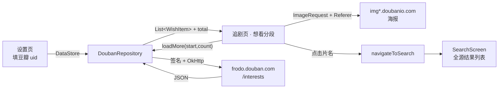

# 豆瓣「想看」接入 MewBox：实施计划

> 状态：**已实施**（2026-11-06 完成编码、构建、装机与真机链路验证；见文末「实施记录」）
> 目标：在「追剧」页增加一栏「豆瓣想看」，列出全部想看条目、滚动加载、点击直接跳全源搜索
> 前置：老大确认 §1.4 拍板项 + 提供豆瓣 uid
> 约束：**不新增顶层 Tab、不改 Room、不加第三方依赖、不引入登录态 / WebView / Cookie**

---

## 一、需求与边界

### 1.1 目标

| # | 需求原文 | 落地解释 |
| -- | -------- | -------- |
| 1 | 在追剧页面增加一栏 | 「追剧」页内新增一个可切换的分段「豆瓣想看」，与「播放记录」并列 |
| 2 | 列出所有想看数据 | 按分页把 `total` 条全部加载完，不截断、不只显示前 N 条 |
| 3 | 滚动加载 | TV 遥控器焦点接近列表末尾时自动取下一页，带 loading / 失败重试 |
| 4 | 和豆瓣想看列表展示的一致 | **字段 + 顺序一致**（详见 §1.3），视觉沿用 MewBox 站内卡片风格 |
| 5 | 点击影片，直接搜索 | 跳 `search?keyword=片名`，由 SearchViewModel 自动执行全源搜索并列出结果，用户自行挑选 |

### 1.2 明确不做（Out of Scope）

- 不做「标为看过 / 删除想看标记」等写操作（需登录 cookie + 豆瓣写接口，且是账号操作，风险高）。
- 不做豆瓣网页的「按评分 / 按年代排序」「宫格 / 列表视图切换」。
- 不做「在看 / 看过 / 书 / 音乐 / 游戏」标记，本期只要影视「想看」。
- 不做多账号、不做账号切换、不做增量同步 / 后台定时刷新。
- 不做自动起播（不复用 `DetailSourceCoordinator.startAutoCrossSourceResolve`），理由见 §1.3。
- 不改数据库（不新增想看表、不升 Room version、不写 Migration）。
- 不动顶层 Tab 枚举与 `FloatingNavBar` / `MewFloatingBottomBar`。

### 1.3 决策记录

| 决策 | 理由 |
| ---- | ---- |
| **用 Frodo App 后端 + HMAC-SHA1 签名，不用网页 wish 页** | 官方 API 2017 停申请、2023 开发者平台下线；网页有 PoW 风控（`sec.douban.com`），纯 OkHttp 抓 HTML 会 302 / 403。Frodo 返回标准 JSON，实测 200，且免登录免 cookie |
| **「一致」收敛为字段 + 顺序一致** | Frodo 能给出豆瓣 wish 页绝大部分展示字段，且 `create_time` 天然倒序 = 豆瓣默认「按时间」。排序切换 / 视图切换 / 标记写操作做不到，照抄网页会欠债 |
| **只用一次 `type=movie` 拉全，不分 movie/tv 两次** | 实测 `type=movie&status=mark` 返回里已混有电视剧（前 50 条 45 电影 + 5 剧集）；`type=tv` 返回同一批条目但 `total` 变成 184，`type` 参数基本被忽略。分两次拉会重复 |
| **点击跳搜索结果页，不自动起播** | `search?keyword=` 会自动跑全源 `searchAll` 并把结果全列出（`SearchViewModel.kt:72-75`），比 `DetailSourceCoordinator` 自动取首个结果起播更不容易播错版本 / 错季；且想看里大量待上映片本来就没有片源 |
| **顶部分段，不左右分栏 / 不顶部横向一行** | 现有追剧页是竖向 `LazyColumn`；「列出全部 + 滚动加载」装不进一行；左右分栏在 TV 遥控器上焦点跨栏易出 bug；分段还避开顶层 Tab 3→4 触发的 `NavMetrics.actionSlotFor` 偶数槽位移 |
| **只缓存进程内内存，不落盘** | 需求没提离线；落 DataStore 大 JSON 或 Room 迁移都是额外成本。断网时保留 ViewModel 已加载部分即可 |
| **海报 header 局部注入，不改全局 Coil** | 项目无 `SingletonImageLoader`，`VodCard` 用 `ImageRequest.Builder`，`HistoryItemCard` 用裸 String。全局注入会波及其他源；只想看卡片自己加 header 最安全 |
| **新建 `@Named("douban")` 专用 OkHttpClient** | 现有 `@Named("api")` client 带 `SSLCompat.apply`（信任所有证书，注释明确「仅源 API 请求专用，禁止全局生效」）。豆瓣是固定公网 HTTPS，不该复用它；专用 client 用标准 TLS + UA / Referer 拦截器 |

### 1.4 开工前待确认（拍板项）

| # | 事项 | 建议默认 | 需老大确认 |
| -- | ---- | -------- | ---------- |
| 1 | 一栏形态 | 顶部分段「播放记录 / 豆瓣想看」 | ☐ |
| 2 | 「一致」口径 | 字段 + 顺序一致，视觉沿用站内卡片 | ☐ |
| 3 | 卡片字段 | 海报 / 片名 / 年份 / 豆瓣评分 / 标记日期 / 电影·剧集徽标；标签与短评默认不显示 | ☐ |
| 4 | 数据范围 | 电影 + 剧集全要，一次 `type=movie` 拉全，用 `subject.type` 打徽标 | ☐ |
| 5 | 排序 | 仅按标记时间倒序，不做排序切换 | ☐ |
| 6 | 同步 | 进入分段自动同步 + 右上角「同步」按钮；无下拉刷新（TV） | ☐ |
| 7 | 缓存 | 仅进程内内存缓存，不落 DataStore / Room | ☐ |
| 8 | 点击行为 | 跳搜索结果页；长按「一键起播」先不加 | ☐ |
| 9 | uid 来源 | 设置页填一次，未填时页面给引导 | ☐ |
| 10 | 开发期基准 uid | 公开 uid `1000001`（`total=77`），仅用于自测，不写进发布配置 | ☐ |

> **未提供真实 uid 前不进入编码阶段**。拿到后先跑 §8 阶段 0 的全量基准验证。

---

## 二、现状调研结论

### 2.1 项目侧可复用能力

| 能力 | 位置 | 复用方式 |
| ---- | ---- | -------- |
| 全源搜索跳转 | `MainActivity.kt:200` `navigateToSearch(keyword)` → `search?keyword=...` | 想看卡片点击直接调，无需新增路由 |
| 搜索自动执行 | `ui/search/SearchViewModel.kt:72-75` `init` 读 `savedStateHandle["keyword"]` 并 `search()` | 传参即自动出结果 |
| 追剧页容器 | `ui/history/HistoryScreen.kt` `Scaffold` + `TopAppBar` + 竖向 `LazyColumn` | 分段 + 第二个列表直接嵌进去 |
| DataStore 配置模式 | `api/config/SettingsRepository.kt:18`（`preferencesDataStore("settings")`） | 加一个 `douban_uid` key 即可，不必新建 DataStore |
| 设置页模式 | `ui/setting/SettingsScreen.kt:187-195` `SettingCard` + `SettingRow` + Dialog | 仿 TMDB 设置行加「豆瓣想看」配置行 |
| DI 客户端模式 | `di/Modules.kt:35-73` `NetworkModule` 提供 `@Named("api")` / `@Named("player")` | 加一个 `@Named("douban")` provider |
| 图片请求 | Coil 3.3.0，`VodCard.kt:83-88` 已用 `ImageRequest.Builder` | 想看卡片照此写法加 header |
| msearch 语义 | `bean/Models.kt:39-49` `isMsearch` / `MSEARCH_PREFIX` | 本期**不生成 Vod**、不进 msearch 链路，仅作为后续「一键起播」的预留 |

> 说明：本期点击走的是 `navigateToSearch`，**不经过** `Vod.isMsearch`、`HomeScreen.kt:258`、`DetailViewModel.kt:139` 那条「豆瓣推荐源 → 详情页 → 自动跨源起播」链路。两者互不干扰。

### 2.2 现有缺口

| 缺口 | 位置 | 影响 |
| ---- | ---- | ---- |
| 追剧页点击是「直接起播」 | `HistoryScreen.kt:128` `onNavigateToPlay` → `play/...` | 想看条目必须单独接 `onNavigateToSearch`，不能复用 |
| 无豆瓣网络层 / 数据模型 | `api/` 下无 `douban` 包 | 需新增 3～4 个文件 |
| 无 HTML 解析库（无 Jsoup） | `gradle/libs.versions.toml` | 不影响：Frodo 返回 JSON，用现有 kotlinx-serialization |
| Coil 无图片 header 注入 | 全项目无 `SingletonImageLoader` / 无 Referer 拦截器 | 不处理则豆瓣海报全部 418 空白 |
| TopAppBar 右上角语义固定 | `HistoryScreen.kt:81-98` 恒为「清空历史」 | 切到想看分段时需换成「同步」 |
| 年份不参与站内匹配 | `SiteRepository.kt:187` `isNameMatched` 仅片名双向 contains | 同名不同年份结果混杂，本期靠用户肉眼挑选，不改 |

### 2.3 豆瓣侧接口实测（2026-11-05，国内直连，系统 Python 3.12）

**实测产物**

| 项目 | 结果 |
| ---- | ---- |
| `GET /api/v2/user/{uid}/interests?type=movie&status=mark&start=0&count=50` | **HTTP 200**，`total=77`，返回 50 条 |
| `start=50&count=50` | **HTTP 200**，返回 27 条（正常末页） |
| 排序 | `create_time` 严格倒序（首条 2018-04-06，末条 2009-12-12），与豆瓣 wish 默认「按时间」一致 |
| 字段完整度 | 50/50 有 `year` 与 `pic`；13 条有 `tags`，5 条有 `comment`，0 条有个人评分（想看本就不评分，合理） |
| 类型分布 | 前 50 条：`movie` 45 / `tv` 5 |
| `type=tv&status=mark` | 返回**同一批**条目，`total` 却为 184 → `type` 参数基本被忽略 |
| 海报直链 | 裸请求 / 仅浏览器 UA → **HTTP 418**；带 `Referer: https://movie.douban.com/` → **200**，`image/webp` 87090 bytes |
| 其它端点 | `movie_top250/items` 带签名 200；Rexxar 搜索接口连续请求会 403 `{"code":103,"msg":"need_login"}`；详情页 302 跳 `sec.douban.com` |

**结论**：Frodo `interests` 端点当前稳定可用，且是**唯一**无需登录、无 PoW、返回结构化 JSON 的路径。但它使用豆瓣 Android App 的公开凭据（从 APK 提取），属逆向通道，**无 SLA**，必须留降级（§9）。

---

## 三、总体设计

### 3.1 数据流



### 3.2 分层

| 层 | 新增类 | 职责 |
| -- | ------ | ---- |
| data | `DoubanModels` | `@Serializable` 响应模型 + UI 模型 `WishItem` |
| data | `DoubanApi` | 签名、发请求、JSON 解析、错误归一化；**不持有状态** |
| data | `DoubanRepository` | 分页游标、去重、节流、内存缓存、错误重试；`@Singleton` |
| config | `SettingsRepository` 扩展 | 只存 `douban_uid` |
| ui | `WishViewModel` | `StateFlow<WishUiState>`，暴露 `loadFirstPage()` / `loadMore()` / `sync()` |
| ui | `WishTab` Composable | 列表、卡片、状态视图、焦点触发加载 |
| di | `NetworkModule` 扩展 | `@Named("douban")` OkHttpClient（标准 TLS + UA / Referer 拦截器） |

依赖方向：`ui → repository → api → OkHttp`。`api` 不依赖 `ui`，`repository` 不依赖 Compose。

### 3.3 状态模型

```kotlin
enum class WishStatus { Idle, Loading, LoadingMore, Refreshing, Empty, Error, NoUid }

data class WishUiState(
    val items: List<WishItem> = emptyList(),
    val total: Int = 0,
    val status: WishStatus = WishStatus.Idle,
    val hasMore: Boolean = true,
    val errorMessage: String? = null,
    val lastSyncAt: Long = 0L,
)

data class WishItem(
    val interestId: Long,      // 去重键，来自 interest.id（Long，稳定）
    val title: String,         // subject.title，搜索关键词
    val year: String,          // subject.year
    val poster: String,        // subject.pic.large，空则 normal
    val doubanRating: String,  // subject.rating.value 格式化，无则「暂无评分」
    val markedAt: String,      // interest.create_time 取前 10 位
    val isTv: Boolean,         // subject.type == "tv"
    val subtitle: String,      // subject.card_subtitle，备用
    val tags: List<String> = emptyList(),
    val comment: String = "",
)
```

> **不用 `subject.id` 做键**：该字段在响应中可能是字符串或数字，`isLenient` 不会自动把数字转 `String`。`interest.id` 实测为 Long，稳定。

---

## 四、接口规格

### 4.1 请求

```
GET https://frodo.douban.com/api/v2/user/{uid}/interests
```

| 参数 | 值 | 说明 |
| ---- | -- | ---- |
| `type` | `movie` | **固定**，一次拉全部影视想看；不要按 movie / tv 分两次 |
| `status` | `mark` | `mark` = 想看；`doing` = 在看；`done` = 看过 |
| `start` | 偏移量 | 首次 0，后续见 §5.1 |
| `count` | `50` | 单页上限 50，再大无意义 |
| `apiKey` | `0dad551ec0f84ed02907ff5c42e8ec70` | 豆瓣 Android App 公开凭据 |
| `_ts` | Unix 秒 | **字符串**，必须与签名用的 ts 完全一致 |
| `_sig` | Base64(HMAC-SHA1) | 见 §4.2 |
| `os_rom` | `android` | 固定 |

**Header**

| 名称 | 值 |
| ---- | -- |
| `User-Agent` | `api-client/1 com.douban.frodo/7.22.0.beta9(231) Android/23 product/Mate40 vendor/HUAWEI model/Mate40 brand/HUAWEI rom/android network/wifi platform/AndroidPad` |

### 4.2 签名算法

```
raw  = "GET" + "&" + urlencode(path, safe="") + "&" + str(ts)
_sig = Base64( HMAC-SHA1(key="bf7dddc7c9cfe6f7", msg=raw) )
```

- **只签 path**（如 `/api/v2/user/xxx/interests`），**绝不带 query**，否则返回 `code 996`。
- `urlencode(path, safe="")` 会把 `/` 编成 `%2F`；`_`、数字、字母不编码。
- `_ts` 用**秒**，不是毫秒。

Kotlin 参考实现：

```kotlin
private fun sign(path: String, ts: Long): String {
    val encodedPath = URLEncoder.encode(path, "UTF-8")   // "/" -> %2F
    val raw = "GET&$encodedPath&$ts"
    val mac = Mac.getInstance("HmacSHA1").apply {
        init(SecretKeySpec("bf7dddc7c9cfe6f7".toByteArray(Charsets.UTF_8), "HmacSHA1"))
    }
    return Base64.encodeToString(
        mac.doFinal(raw.toByteArray(Charsets.UTF_8)), Base64.NO_WRAP
    )
}
```

> 建议用 OkHttp `HttpUrl.Builder` 拼 query（自动处理 `_sig` 里的 `+` `/` `=`），不要手写字符串拼接。
> 验收：同一 `path` + `ts` 用 Python 参考脚本与 Kotlin 实现分别算出的 `_sig` 必须逐字节一致（见 §8 阶段 1）。

### 4.3 响应字段映射

```kotlin
@Serializable data class DoubanInterestsResponse(
    val start: Int = 0,
    val count: Int = 0,
    val total: Int = 0,
    val interests: List<DoubanInterest> = emptyList(),
)

@Serializable data class DoubanInterest(
    val id: Long = 0L,
    val status: String = "",
    @SerialName("create_time") val createTime: String = "",
    val comment: String = "",
    val tags: List<String> = emptyList(),
    val subject: DoubanSubject = DoubanSubject(),
)

@Serializable data class DoubanSubject(
    val title: String = "",
    val year: String = "",
    val pic: DoubanPic? = null,
    val rating: DoubanRating? = null,
    @SerialName("card_subtitle") val cardSubtitle: String = "",
    val type: String = "",          // "movie" | "tv"
    val subtype: String = "",
    @SerialName("is_released") val isReleased: Boolean? = null,
)

@Serializable data class DoubanPic(val large: String = "", val normal: String = "")
@Serializable data class DoubanRating(val value: Double? = null, val count: Int = 0)
```

解析必须用 `Json { ignoreUnknownKeys = true; isLenient = true }`：响应含大量未声明字段（`color_scheme`、`actors`、`sharing_url` 等），且部分字段类型不稳定。

| 页面显示 | 来源 | 兜底 |
| -------- | ---- | ---- |
| 片名 | `subject.title` | 空则跳过该条 |
| 年份 | `subject.year` | 空则不显示年份段 |
| 豆瓣评分 | `subject.rating.value` | `null` → 「暂无评分」 |
| 标记日期 | `interest.create_time.take(10)` | 空则只显示年份评分 |
| 类型徽标 | `subject.type == "tv"` | 非 tv 一律「电影」 |
| 海报 | `subject.pic.large` → `normal` | 空 → `PosterPlaceholder` |
| 副信息（备用） | `subject.card_subtitle` | 长按 / 后续详情用 |

> `interest.rating`（个人评分，max 5）与 `subject.rating`（社区评分，max 10）是两套量纲，**不要混用**。本期只用社区评分。

### 4.4 错误码与归一化

| 现象 | 判定 | 页面处理 |
| ---- | ---- | -------- |
| `code 997` / `invalid_request_997` | 签名缺失 | 统一提示「豆瓣接口已变更，请稍后重试」，写 Timber.w，不走无限重试 |
| `code 996` | 签名错误（多半签了整 URL 或 ts 不一致） | 同上，开发期断言日志 |
| `code 103` / `need_login` | 风控 / 限流 | 提示「豆瓣请求过于频繁，稍后再试」，退避后允许手动重试 |
| HTTP 403 | 频率限制 | 指数退避（1s → 2s → 4s），最多 2 次自动重试 |
| HTTP 200 但 `total = 0` | 可能是真没有，也可能是私密账号 / 风控静默 | 显示「未获取到想看条目」并提示「请检查豆瓣 uid 与账号隐私设置」，**不要误报「你还没有想看」** |
| 网络异常 / 超时 | 无响应 | 保留已加载列表，列表尾部显示「加载失败，点击重试」 |
| 海报 418 | 缺 Referer | 卡片内 `ImageRequest` 注入 header；仍失败回落 `PosterPlaceholder` |

### 4.5 频率控制

- 滚动触发天然有间隔，不加固定 1.5s 延迟（TV 体验差）。
- Repository 内用 `Mutex` 串行化请求 + 两次请求最小间隔 **800ms** 节流，防止快速连按连发。
- 连续分页超过 `MAX_PAGES = 40`（≈2000 条）强制停止并提示，避免异常 total 导致死循环。
- 同步按钮点击时若距上次成功 < 30s，直接跳过（可长按强制）。

---

## 五、分页与滚动加载

### 5.1 算法

```
loadFirstPage():
    clear items / seenIds / nextStart = 0
    status = Loading
    fetch()

loadMore():
    if (status in [Loading, LoadingMore, Refreshing]) return   // 防并发
    if (!hasMore) return
    fetch()

fetch():
    resp = api.interests(uid, start = nextStart, count = 50)
    newItems = resp.interests
                  .filter { it.subject.title.isNotBlank() }
                  .map(::toWishItem)
                  .filter { seenIds.add(it.interestId) }        // 去重
    items = items + newItems
    total = resp.total
    nextStart = resp.start + resp.interests.size                 // 游标 = 服务端偏移 + 实际返回条数
    hasMore = newItems.isNotEmpty()
              && items.size < resp.total
              && pages < MAX_PAGES
    status = when { items.isEmpty() && resp.total == 0 -> Empty; else -> Idle }
```

**为什么 `nextStart` 用「服务端 start + 实际返回条数」而不是 `page * 50` 或 `items.size`**：
豆瓣的 `start` 是服务端偏移，中途在 App 里新增 / 删除标记会让偏移漂移；用累计实际条数作游标最贴近服务端语义。配合 `interestId` 去重与 `total` 终止，可容忍漂移造成的重复页。

### 5.2 三个已验证的坑

| 坑 | 现象 | 对策 |
| -- | ---- | ---- |
| 用「本页少于 count」当结束条件 | 实测 `start=50` 只返回 27 条（< 50），这正是**最后一页**；若同时有下架条目，还可能提前误判 | 终止条件只用 `items.size >= total` 或 `newItems.isEmpty()` |
| 按 movie / tv 分两次拉 | `type=tv` 返回同一批条目、`total` 变 184 | 只调 `type=movie` 一次，UI 用 `subject.type` 打徽标 |
| 翻页期间豆瓣清单变动 | `start` 偏移漂移，偶发重复 / 漏条 | `seenIds` 去重 + `total` 终止 + `MAX_PAGES` 兜底；不做静默无限重试 |

### 5.3 TV 焦点触发

用 `LazyListState` + `snapshotFlow` 在焦点接近末尾时预加载，阈值取倒数第 4 项，避免用户看到 loading 卡顿：

```kotlin
val listState = rememberLazyListState()
LaunchedEffect(listState) {
    snapshotFlow {
        val last = listState.layoutInfo.visibleItemsInfo.lastOrNull()?.index ?: 0
        last to state.items.size
    }
        .distinctUntilChanged()
        .collect { (last, size) ->
            if (size > 0 && last >= size - 4) viewModel.loadMore()
        }
}
```

要点：

- 列表尾部插一个 loading / 重试 `item`，但它**不参与 `items.size` 游标计算**。
- loading item 不加 `focusable()`，避免遥控器焦点落到加载条上出不去。
- 分页返回后不 `scrollToItem(0)`，保持当前焦点位置；Compose 的 `key = interestId` 保证已渲染项不重组错位。

---

## 六、UI 设计

### 6.1 分段切换

- 在 `HistoryScreen` 的 `TopAppBar` 下方加一行两个 pill：「播放记录」「豆瓣想看 N」（N 取 `total`，未加载时显示「豆瓣想看」）。
- 选中态用 `rememberSaveable { mutableStateOf(0) }` 保存，切换顶层 Tab 再回来保持上次分段。
- 「播放记录」分支保持**现有 `LazyColumn` + `HistoryItemCard` 完全不动**；「豆瓣想看」分支挂 `WishTab`。
- 分段状态放在 `HistoryScreen` 内，**不改 `HistoryViewModel`**；`WishTab` 自己 `hiltViewModel()` 拿 `WishViewModel`。

### 6.2 想看卡片

沿用 `HistoryItemCard` 的横条结构（左侧 84dp 竖版海报 + 右侧信息列），保证两栏视觉统一：

| 区域 | 内容 |
| ---- | ---- |
| 左 | 海报 84×112dp，`RoundedCornerShape(8.dp)`，失败回落 `PosterPlaceholder` |
| 右·第一行 | 片名 `titleMedium` + 单行省略 |
| 右·第二行 | 徽标「电影 / 剧集」+ `年份 · 豆瓣 8.2 · 2018-04-06 标记` |
| 右·第三行（可选） | `card_subtitle` 截断显示（默认关闭，见 §1.4 第 3 项） |
| 点击 | `onNavigateToSearch(item.title)` |
| 长按 | 本期无操作（不弹菜单） |

> 标签 / 短评数据已能取到，但 TV 横条一行放不下，默认不显示；若老大要，改为长按弹 `AlertDialog` 展示。

### 6.3 状态视图

| 状态 | 展示 |
| ---- | ---- |
| `NoUid` | 「尚未设置豆瓣账号」+ 按钮「去设置」→ 跳设置页（或就地弹 uid 输入 Dialog） |
| `Loading` | 全屏 `LoadingState("正在同步豆瓣想看...")` |
| `Empty` | 「未获取到想看条目」+ 检查 uid / 隐私设置提示 + 「重新同步」 |
| `Error`（首屏） | 居中错误文案 + 「重试」按钮，保留上次内存数据（若有） |
| `Idle` | 列表；右上角显示「已加载 X / total」 |
| `LoadingMore` | 列表尾部转圈，`hasMore = false` 后显示「已全部加载 · 共 N 条」 |
| 加载失败（尾部） | 尾部「加载失败，点击重试」，不清空已加载项 |

### 6.4 TopAppBar 语义切换

`HistoryScreen.kt:81-98` 的 actions 现在是恒定的「清空历史」。改为按分段切换：

| 分段 | 右上角 |
| ---- | ------ |
| 播放记录 | 现有的删除 Icon + 清空确认弹窗（**行为不变**） |
| 豆瓣想看 | 同步 Icon（`Icons.Default.Refresh`）+ 触发 `viewModel.sync()`；长按可强制同步 |

标题仍为「追剧」，不改。

### 6.5 点击链路（改前后对照）

| | 改前 | 改后 |
| -- | ---- | ---- |
| 播放记录条目 | `onNavigateToPlay(...)` → `play/...` 直接起播 | **不变** |
| 想看条目 | 无 | `onNavigateToSearch(title)` → `search?keyword=<Uri.encode(title)>` → `SearchViewModel.init` 自动 `search()` → 全源结果列表 |

`MainActivity.kt` 只需在 `Tab.Keep` 分支多传一个参数（该参数已在 `MainContent` 签名里，`:433`）：

```kotlin
Tab.Keep -> HistoryScreen(
    onNavigateToPlay = onNavigateToPlayFromHistory,
    onNavigateToSearch = onNavigateToSearch,   // 新增
)
```

关键词**只用纯片名**，不拼年份 / 类型：站内源片名未必带年份，拼了反而搜不到；同名不同年份的结果由用户在搜索结果页自行挑选。

### 6.6 海报防盗链（必做）

想看卡片内用 `ImageRequest.Builder` 注入 header，**不动全局 Coil、不动 `VodCard`**：

```kotlin
val request = remember(context, item.poster) {
    ImageRequest.Builder(context)
        .data(item.poster)
        .setHeader("Referer", "https://movie.douban.com/")   // Coil 3.3.0 API 名以 IDE 补全为准
        .build()
}
AsyncImage(model = request, ...)
```

> 实施前先用 5 分钟确认 Coil 3.3.0 的 header API（可能是 `setHeader` / `httpHeaders`）。若不可用，退路是在 `WishTab` 内构造局部 `ImageLoader`（配一个带 Referer `Interceptor` 的 OkHttpClient）传给 `AsyncImage(imageLoader = ...)`，仍不改全局。
> **验收**：Logcat 或抓包确认图片请求返回 200 而非 418，卡片能显示真实海报。

---

## 七、改动清单

| 文件 | 类型 | 内容 |
| ---- | ---- | ---- |
| `api/douban/DoubanModels.kt` | 新增 | `@Serializable` 响应模型 + `WishItem` + `WishUiState` / `WishStatus` |
| `api/douban/DoubanApi.kt` | 新增 | 签名、OkHttp 请求、JSON 解析、错误归一化 |
| `api/douban/DoubanRepository.kt` | 新增 | 分页游标、`seenIds` 去重、Mutex 节流、内存缓存、重试上限 |
| `ui/history/WishViewModel.kt` | 新增 | `StateFlow<WishUiState>`，`loadFirstPage` / `loadMore` / `sync` |
| `ui/history/WishTab.kt` | 新增 | 列表、卡片、状态视图、焦点预加载、海报 header |
| `ui/setting/DoubanDialog.kt` | 新增 | uid 输入 / 校验 / 保存 |
| `di/Modules.kt` | 修改 | 新增 `@Named("douban")` OkHttpClient provider（标准 TLS + UA / Referer 拦截器） |
| `api/config/SettingsRepository.kt` | 修改 | 加 `douban_uid` key、`doubanUidFlow`、`setDoubanUid()` |
| `ui/setting/SettingsViewModel.kt` | 修改 | 暴露 uid 与保存方法 |
| `ui/setting/SettingsScreen.kt` | 修改 | 加「豆瓣想看」`SettingRow` + 弹窗状态 |
| `ui/history/HistoryScreen.kt` | 修改 | 分段切换、想看分支、TopAppBar actions 按分段切换、新增 `onNavigateToSearch` 参数 |
| `MainActivity.kt` | 修改 | `Tab.Keep` 分支多传 `onNavigateToSearch`（约 `:506`） |

**明确不动**：`AppDatabase.kt` / `Entities.kt`（无 Room 迁移）、`HistoryViewModel.kt`、`VodCard.kt`、`SiteRepository.kt`、`api/tmdb/*`、顶层 `Tab` 枚举、`NavMetrics.kt`、两套 FloatingNavBar、`build.gradle.kts` / `libs.versions.toml`（**零新依赖**：OkHttp 5.1.0、kotlinx-serialization 1.8.1、DataStore 1.1.7、Coil 3.3.0 均已具备）。

---

## 八、实施步骤与验收

| 阶段 | 内容 | 验收标准 |
| ---- | ---- | -------- |
| **0 · 基准验证**（先于编码） | 用老大真实 uid 跑 Python 探针：签名、全量分页、`total`、去重后条数、字段完整度、海报 Referer | 输出「total / 实际条数 / 首条片名 / 末条片名 / 电影剧集分布 / 图片 200」报告；重复两次结果一致；与公开 uid `1000001`（total=77）交叉验证分页逻辑 |
| **1 · 数据层** | 新增 `DoubanModels` / `DoubanApi` / `DoubanRepository` + DI client | 单测或临时入口：同一 `path`+`ts` 的 Kotlin `_sig` 与 Python 参考值逐字节一致；`start=0` 解析出 50 条、`start=50` 解析出 27 条；未知字段不抛异常；`code 997/996/103` 能归一化 |
| **2 · 配置层** | `SettingsRepository` 加 uid + 设置页 Dialog | 填 uid 保存后杀进程重进仍在；清空 uid 后想看页显示「尚未设置」引导；非法输入（空格 / URL）能自动提取 people 段 |
| **3 · UI** | `WishViewModel` + `WishTab` + 分段 + 卡片 | 首屏 50 张卡片海报**全部**可见（非占位图）；字段与豆瓣 wish 页逐条比对一致；顺序与标记时间倒序一致；剧集显示「剧集」徽标 |
| **4 · 联动** | 接 `onNavigateToSearch`、TopBar 同步按钮、焦点预加载 | 点击任意卡片跳搜索页并自动出结果；播放记录点击仍是直接起播；右上角按分段切换；焦点到倒数第 4 项自动加载下一页，不丢焦点、不重复、不漏条；末页显示「已全部加载 · 共 N 条」 |
| **5 · 回归** | 全量构建 + TV 遥控器走查 | `./gradlew assembleDebug` 通过；顶层 3 Tab / 导航栏几何无变化；TMDB、搜索、播放、历史记录行为与改动前一致 |

每阶段结束给老大一份验证产物（日志 / 计数 / 截图），**不跨阶段攒着一起报**。

---

## 九、风险与降级

| 风险 | 概率 | 影响 | 降级方案 |
| ---- | ---- | ---- | -------- |
| 豆瓣更换签名算法 / 作废公开 apiKey | 中 | 想看页完全不可用 | 错误提示明确「豆瓣接口已变更」；保留内存缓存展示；预留「导入 CSV / JSON」入口（社区导出工具可生成），本期只留接口不实现 |
| 触发风控 403 / `need_login` | 中 | 分页中断 | 退避重试 + 尾部「点击重试」；不清空已加载部分 |
| 私密账号返回 `total=0` | 低 | 误以为没数据 | 提示检查 uid / 隐私设置，不显示「你还没有想看」 |
| 图片 CDN 加强防盗链 | 低 | 海报空白 | 局部 `ImageLoader` + 拦截器；或降级为 `PosterPlaceholder` + 文字卡片 |
| 翻页期间清单变动 | 低 | 重复 / 漏条 | `seenIds` 去重 + `total` 终止 + 手动同步可刷新 |
| 片名在站内源搜不到 | **高** | 搜索页空结果 | 属预期行为（想看含大量待上映 / 冷门片）；空结果态由 `SearchResultPage` 现有文案承担，必要时在想看卡片上标注「未上映」（`subject.is_released`） |
| 同名不同年份误选 | 中 | 用户选错版本 | 本期靠用户肉眼挑选；后续若要自动匹配，再用 `year` 给 `isNameMatched` 加权（本期不改） |
| 凭据硬编码的合规性 | — | 长期维护 | 凭据是豆瓣 App 公开常量，不涉个人账号；不写任何 cookie / token；README 注明数据来源与「随时可能失效」 |

---

## 十、验证清单

- [ ] `./gradlew assembleDebug` 通过，无新增依赖、无 Room 迁移
- [ ] 首次进入想看分段：显示 Loading → 50 条卡片，海报全部真实可见（无 418 / 无占位图刷屏）
- [ ] 字段逐条比对：片名 / 年份 / 豆瓣评分 / 标记日期 / 电影剧集徽标与豆瓣 wish 页一致
- [ ] 顺序为标记时间倒序，首条与末条与 Python 探针结果一致
- [ ] 焦点滚到末尾自动加载：77 条全部出齐，无重复、无遗漏，末页显示总数
- [ ] 快速连按 / 快速滚动不产生并发重复请求（Mutex + 节流生效）
- [ ] 断网：首屏给错误 + 重试；已加载 50 条时断网，列表不消失，尾部可重试
- [ ] 清空 uid / 填非法 uid / 私密账号：分别显示引导 / 校验提示 / 隐私设置提示，不误报「暂无想看」
- [ ] 点击想看条目 → 搜索页自动执行全源搜索并返回结果；返回键回到想看分段且滚动位置保持
- [ ] 播放记录分段：点击仍直接起播、长按删除、右上角清空历史，行为与改前完全一致
- [ ] 右上角按钮随分段切换（清空历史 ↔ 同步），同步后条数与豆瓣一致
- [ ] 顶层 3 Tab、两套 FloatingNavBar、TMDB 详情页、msearch 跨源起播无回归
- [ ] Logcat 无 `code 996/997`；如有 403，退避与重试日志符合预期

---

## 十一、开放问题（本期不解决，留档）

1. 是否需要「在看 / 看过」分段？Frodo 只需把 `status` 换成 `doing` / `done`，数据层可复用。
2. 是否需要在 App 内「标为看过 / 取消想看」？需要登录 cookie + 豆瓣写接口，且属账号写操作，本期明确不做。
3. 是否需要离线可见（落 DataStore / Room）？当前只做进程内缓存。
4. 是否需要把想看清单接入首页推荐位 / 复用 msearch 一键起播？现有 `Vod.isMsearch` 链路已具备，后续可低成本接。
5. 是否给 `SiteRepository.isNameMatched` 加年份加权？需先量化误命中率，本期不改。
6. 签名凭据失效后的兜底：是否要实现 CSV / JSON 手动导入？建议观察一段时间再定。

---

## 十二、实施记录（2026-11-06）

### 12.1 落地清单

| 文件 | 状态 |
| ---- | ---- |
| `api/douban/DoubanModels.kt` | ✅ 新增（DTO + WishItem/WishUiState + toWishItem 映射） |
| `api/douban/DoubanApi.kt` | ✅ 新增（HMAC-SHA1 签名 + 错误码归一化） |
| `api/douban/DoubanRepository.kt` | ✅ 新增（分页游标 + COW 缓存 + Mutex 节流 + 403 退避） |
| `ui/history/WishViewModel.kt` | ✅ 新增（含 uid 变化自动同步、30s 同步节流） |
| `ui/history/WishTab.kt` | ✅ 新增（焦点预加载 + 海报 header + 尾部状态条） |
| `ui/setting/DoubanDialog.kt` | ✅ 新增（uid 输入 / people 段提取 / 内联校验） |
| `di/Modules.kt` | ✅ 新增 `@Named("douban")` client（标准 TLS + Frodo UA） |
| `api/config/SettingsRepository.kt` | ✅ `douban_uid` key + flow + setter + `normalizeDoubanUid` |
| `ui/setting/SettingsViewModel.kt` / `SettingsScreen.kt` | ✅ 设置行 + 弹窗接入 |
| `ui/history/HistoryScreen.kt` | ✅ 分段 pill + TopBar actions 分段切换 + `onNavigateToSearch` |
| `MainActivity.kt` | ✅ `Tab.Keep` 分支传 `onNavigateToSearch` |
| `app/src/test/.../DoubanApiTest.kt` | ✅ 新增 4 项单测（签名逐字节比对 Python 参考值） |

零新依赖、零 Room 迁移、顶层 Tab / NavMetrics / FloatingNavBar 未动，符合全部约束。

### 12.2 实测中新增的坑（计划文档之外的发现）

| 坑 | 现象 | 修复 |
| -- | ---- | ---- |
| **豆瓣图片 CDN 校验 UA** | 只带 Referer 不够：`okhttp UA + Referer → 403 Forbidden`；必须浏览器 UA + Referer 才 200（§2.3 实测漏了这层） | `WishItemCard` 的 `ImageRequest` 同时注入 `Referer` + `User-Agent(浏览器)`，常量收在 `DoubanApi.BROWSER_UA` |
| Coil 3.3.0 header API | 既非 `setHeader` 也非顶层方法，是 `coil3.network.httpHeaders(NetworkHeaders)` 扩展 | 已按 javap 反编译确认后使用 |
| 模拟器自动化启动 | dnplayer 直接启动会因沙箱拦截 `sc.exe` 中断 | 用 `ldconsole launch --index 0` 后台拉起 |

### 12.3 验证产物（雷神模拟器 / LDPlayer9 Android 9）

- 单测：`testDebugUnitTest` 4/4 通过，Kotlin `_sig` 与 Python 探针参考值逐字节一致（`ts=1767400000 → aiqb0ba64vxt7Reo/6WzPxLLzjs=`）。
- 基准 uid `1000001`：`total=77`、两轮探针条目/顺序完全一致、海报 Referer 200（报告：`build/douban_probe_report.json`）。
- 真实 uid 运行：`start=0 返回=50 累计=50/85` → 滚动到底自动触发 `start=50 返回=35 累计=85/85 hasMore=false`，尾部显示「已全部加载 · 共 85 条」。
- 海报：修复 UA 前报 `HTTP 403`（logcat `豆瓣海报加载失败`）；修复后错误计数 **0**，卡片无占位符。
- 点击「三块广告牌」→ 搜索 → 详情/选集页（4K原盘 13.6GB 真实片源）端到端走通。
- TopBar：想看分段右上角 content-desc 为「同步豆瓣想看」，播放记录分段仍为「清空历史」。
