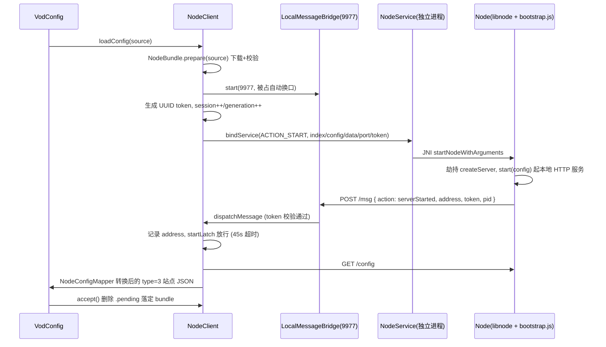

# MewBox Node.js 源功能架构梳理

> 版本：v1.0（2026-10-29）
> 范围：`app/src/main/assets/nodejs/` + `com.fongmi.nodejs` + `com.mewbox.tv.engine.nodejs`
> 架构基准：对齐 FongMi/TV 的 NodeBridge / CatVod 协议

---

## 1. 总体思路

MewBox 的 Node.js 源采用「**内嵌 Node 运行时 + 远程 JS Bundle**」方案：

- App 内置 `libnode.so`（Node 引擎）+ `libnodebridge.so`（JNI 桥），在独立 Service 进程里跑一个真正的 Node.js。
- 爬虫业务代码（bundle）不打包进 APK，而是运行时从订阅地址（`.../index.js.md5`）下载，经 MD5 + 可选 RSA 签名校验后缓存到私有目录。
- Node 侧起一个本地 HTTP 服务承载爬虫接口，宿主通过 HTTP 正向调用；JS 侧通过本地回环桥（`POST /msg`）反向回调宿主能力。

```text
┌─────────────────────────────────────────────────────────┐
│  Kotlin 宿主层（App 主进程）                              │
│  VodConfig · NodeClient · NodeBundle · NodeSpider        │
│  LocalMessageBridge(9977) · NodeRoute · NodeConfigMapper │
└───────────────┬─────────────────────────────────────────┘
                │ bindService + token
┌───────────────▼─────────────────────────────────────────┐
│  Node 运行时进程（Service · 内嵌 libnode）                │
│  NodeService · libnode.so · libnodebridge.so (JNI)      │
└───────────────┬─────────────────────────────────────────┘
                │ JNI startNodeWithArguments
┌───────────────▼─────────────────────────────────────────┐
│  Node.js Bundle（远程下载的 JS 包）                       │
│  bootstrap.js · index.js start(config) · 本地 HTTP 服务  │
└─────────────────────────────────────────────────────────┘
```

---

## 2. 组件清单与职责

### 2.1 JS 侧（assets/nodejs/）

| 文件 | 职责 |
|---|---|
| `bootstrap.js` | 唯一的内置 JS（启动壳），职责： ① 劫持 `http.createServer`，捕获 bundle 创建的**首个**服务并通过桥上报 `serverStarted`（含 address/pid/version/arch）；② 劫持 `http.request`，给发往桥（`POST http://127.0.0.1:<bridgePort>/msg`）的请求自动注入 `X-CatVod-Token`；③ 暴露 `globalThis.catServerFactory(handler)`，包装 bundle 的服务并附加 `/__catvod_health` 健康检查端点（token 常量时间比较，返回 `6*7`）；④ 依次 `require(index.config.js)` 与 `index.js`，调用 `runtime.start(config)`；⑤ 启动失败时上报 `nodeError` 后 `exit(1)` |

命令行参数约定（由 JNI 传入）：

```text
node <bootstrap.js> <index.js 路径> <index.config.js 路径> <dataRoot> <bridgePort> <token> <libnodebridge.so 路径>
```

### 2.2 Kotlin 侧 — com.fongmi.nodejs

| 类 | 职责 |
|---|---|
| `NodeService` | 独立运行时进程的 Android Service。加载 `c++_shared`/`node`/`nodebridge` 三个 so，经 JNI `startNodeWithArguments` 拉起 Node；先把 `assets/nodejs/bootstrap.js` 释放到 `filesDir/nodejs/runtime/bootstrap-v2.js`；所有传入路径强制限制在 `filesDir/nodejs` 内（canonical 路径前缀校验）；Node 退出或抛异常后向桥回报 `nodeError` 并 `killProcess`（onDestroy 同样自杀） |
| `NodeBundle` | bundle 下载/校验/缓存管理器（详见 §3） |
| `NodeManifest` | 签名清单校验：`SHA256withRSA`，域分隔串 `catvod-node-bundle-v1`，RSA 公钥 ≥2048 位；校验 `indexSha256`/`configSha256` 与文件实际摘要一致、签名有效、指纹与已固定 `trusted-key.sha256` 一致 |
| `NodeClient` | 运行时总控（详见 §4） |
| `LocalMessageBridge` | 反向消息桥（详见 §5） |
| `NodeRoute` | `node:` scheme 路由工具：`append(api, "/home")` 拼子路径、`path(api)` 取路径，校验 api 必须以 `node:` 开头 |
| `NodeConfigMapper` | 把 Node 服务 `GET /config` 返回的 `{ data: { video: { sites: [...] } } }` 转成 TVBox 标准站点列表：站点强制 `type=3`、`api` 改写为 `node:/spider/<key>/<type>`（或取 site.api 的路径部分），`enable=false` 的站点剔除 |
| `Path` / `Crypto` | 原子写文件（temp+rename+fsync）/ MD5、SHA-256、hex 工具 |

### 2.3 Kotlin 侧 — com.mewbox.tv.engine.nodejs（引擎接入层）

| 类 | 职责 |
|---|---|
| `NodeRuntime` | Hilt `@Singleton` 门面，包装 `NodeClient`：`loadConfig` / `ensureStarted` / `accept` / `clear` |
| `NodeSpiderLoader` | `SpiderLoader` 实现：`type == 3` 或 `api` 以 `node:` 开头即接管；按 `key|api|ext` 缓存 Spider 实例 |
| `NodeSpider` | `Spider` 六方法 → Node HTTP 接口映射（见下表）；结果统一走 `ResultParser` 容错解析并打上 `siteKey/siteName` 角标；兼容老 `baseset` 配置源（自动补 `action` 字段、`/action` 404 时降级走 `/detail`） |

Spider 方法与 Node 接口映射：

| Spider 方法 | POST 接口 | 请求体字段 |
|---|---|---|
| `init(ext)` | `/init` | `ext`、`extend`（并记入重放列表） |
| `homeContent(filter)` | `/home` | `filter` |
| `homeVideoContent()` | `/homeVod` → 404 时 `/homeVideo` | 空 |
| `categoryContent(tid, pg, ...)` | `/category` | `id`、`page`、`filter`、`filters` |
| `detailContent(ids)` | `/detail` | `id` |
| `searchContent(keyword, ...)` | `/search` | `wd`、`quick`、`page` |
| `playerContent(flag, id, ...)` | `/play` | `flag`、`id`、`flags`（并 setPlayInfo 供桥回查） |
| `action(action)` | `/action`（404 降级 `/detail`） | `action`；响应内 `web` 对象回环地址会被 normalize |

---

## 3. Bundle 下载与校验（NodeBundle）

### 3.1 订阅地址约定

- 地址**必须以 `index.js.md5` 结尾**（`content://` 除外），判定见 `NodeBundle.isConfig()`。
- 其余 companion 文件按同目录规则推导：

```text
https://host/path/index.js.md5          ← 订阅地址（index.js 的 MD5 sidecar）
https://host/path/index.js              ← 主业务 JS（≤32MB）
https://host/path/index.config.js       ← 配置模块（≤2MB）
https://host/path/index.config.js.md5   ← 配置 MD5
https://host/path/index.manifest.json   ← 可选签名清单（≤32KB）
```

### 3.2 缓存与校验流程

```mermaid
flowchart TD
    A[导入 index.js.md5 地址] --> B[本地已有缓存? nodejs/bundles/sha256(地址)/active]
    B -->|有| C{远端 MD5 与缓存一致?}
    B -->|无| D[下载到 staging-UUID]
    C -->|一致且清单校验通过| E[直接复用缓存]
    C -->|不一致| D
    D --> F[index.js / index.config.js MD5 校验]
    F -->|失败| G[报错, 清理 staging]
    F -->|通过| H{有 manifest?}
    H -->|有| I[RSA 签名 + SHA256 + 指纹校验]
    H -->|无| J{曾固定过 trusted-key?}
    J -->|是| G2[拒绝: 已签名不可降级为无签名]
    J -->|否| K
    I -->|通过| K[写 sidecar + .pending, staging→active 原子提交]
    I -->|失败| G
    K --> L[启动运行时, 启动成功后 accept 落定]
```

关键规则：

- **原子性**：先写 `staging-<uuid>`，全部校验通过后 rename 为 `active`；写 `.pending` 标记，运行时启动成功后 `accept()` 删除标记（崩溃回滚保护）。
- **降级复用**：远端网络异常时，若本地已有此前校验通过的缓存 bundle，则降级复用，不阻断使用。
- **指纹固定**：首次接受签名 bundle 后，把签名公钥指纹写入 `trusted-key.sha256`；此后同一订阅源的签名密钥变更会被拒绝。
- **清理**：`prune()` 按「仍在订阅中的源 SHA256 集合」删除孤儿 bundle 目录；staging/`.downloads` 残留每次 prepare 前清理。

---

## 4. 运行时生命周期（NodeClient）

### 4.1 启动时序



### 4.2 并发与一致性控制

| 机制 | 说明 |
|---|---|
| `session` / `generation` | 双计数器：session 标记一次配置加载会话，generation 标记一次运行时实例；请求返回前必须核对两者，过期请求直接作废（`InterruptedIOException`） |
| `loadCancellation` | 取消令牌贯穿「下载 → 启动 → 拉 config」全程；换源/清理时立即生效 |
| 请求超时分档 | `/init` `/support` `/action` → 15s；`/play` `/proxy` → 60s；其余 → 45s（均 NO_PROXY 直连回环） |
| 自动恢复 | 请求级传输失败（非超时）→ `recover()`：重启运行时 + **按原顺序重放全部 `/init`** → 重试一次；超时只作废不重启 |
| 崩溃感知 | `NodeConnection` 监听 `onServiceDisconnected / onBindingDied / binderDied`，第一时间释放 latch 并标记失败 |
| 响应体限额 | config 4MB、普通 JSON 16MB，超限抛 `NodeResponseException` |

### 4.3 离线恢复

- 当前源地址写入 `filesDir/nodejs/active_source`；进程重启后按 `restoreBundle()`：指定源 → active_source → 最近修改的 bundle 依次恢复。
- 恢复启动后同样重放 `/init` 列表，站点无需重新走下载流程。

---

## 5. 反向消息桥（LocalMessageBridge）

- 监听 `127.0.0.1:9977`（被占用时回退任意可用端口），仅处理 `POST /msg`，token 不匹配返回 403，body 上限 4MB。
- 消息格式：`{ "action": "...", "opt": {...} }`。

| action | 处理方 | 行为 |
|---|---|---|
| `serverStarted` | NodeClient | 校验 token 与 generation，记录 Node 服务地址/PID/版本，放行启动等待 |
| `nodeError` | NodeClient | 记录错误信息，放行启动等待（以异常结束） |
| `queryProfile` / `saveProfile` | NodeClient | 读写 `bundles/<源>/../profile.json`（原子写） |
| `getPlayInfo` | NodeClient | 返回当前 `flag`/`id`（由 `playerContent` 时 setPlayInfo 注入） |
| `openInternalWebview` / `openWeb` | Bridge | 打开内部 WebActivity（扫码登录、扩展后台等场景） |
| `toast` | Bridge | 主线程 Toast |
| `getCookie` / `setCookie` | Bridge | 读写 WebViewCookies |
| `getUserAgent` | Bridge | 返回 WebView 默认 UA |

bootstrap.js 已对 `http.request` 打补丁：所有发往该桥的请求自动携带 `X-CatVod-Token`，bundle 代码无需感知 token。

---

## 6. 端到端流程图

```mermaid
flowchart TD
    S1[① 导入订阅 · index.js.md5 地址] --> S2[② 下载与校验<br/>MD5 + RSA 签名 · staging→active 缓存]
    S2 --> S3[③ 拉起运行时<br/>9977 桥 + token · bindService]
    S3 --> S4[④ bootstrap.js<br/>libnode 执行 · start(config) 起服务]
    S4 --> S5[⑤ 就绪上报<br/>POST /msg serverStarted · 45s 超时]
    S5 --> S6[⑥ GET /config<br/>NodeConfigMapper 转 type=3 node: 站点]
    S6 --> S7[⑦ Spider 路由<br/>NodeSpiderLoader 按站点缓存实例]
    S7 --> S8[⑧ 爬虫接口调用<br/>POST /init /home /detail /search /play<br/>ResultParser 解析进 UI]
```

播放直链若指向 Node 本地服务（`/proxy`），由 `NodeClient.proxy()` 流式转发给 ExoPlayer：60s 长超时、透传 Range/UA/Referer/Origin、返回 `[code, contentType, stream, headers]` 四元组。

---

## 7. 存储布局

```text
<filesDir>/nodejs/
├── runtime/bootstrap-v2.js        # 从 assets 释放的启动壳
├── active_source                  # 当前激活订阅地址
├── bundles/
│   └── <sha256(订阅地址)>/
│       ├── active/                # 已落定的 bundle
│       │   ├── index.js
│       │   ├── index.config.js
│       │   ├── index.js.md5 / index.config.js.md5
│       │   ├── index.manifest.json
│       │   └── .pending           # 启动成功前存在的落定标记
│       ├── trusted-key.sha256     # 已固定的签名公钥指纹
│       └── profile.json           # Node 侧持久化配置
├── data/                          # Node 进程的 HOME/cwd
```

---

## 8. 设计要点小结

1. **双通道通信**：正向 HTTP（宿主 → Node 爬虫接口）+ 反向 HTTP（Node → 9977 桥回调宿主）。
2. **安全边界**：路径白名单（`filesDir/nodejs`）、bundle MD5 强校验 + 可选 RSA 签名 + 密钥指纹固定、桥 token 鉴权、回环 only（NO_PROXY）。
3. **故障自愈**：请求级失败自动重启运行时并重放 `/init`；Service 崩溃 binderDied 感知；断网降级复用旧 bundle；重启后按 active_source 静默恢复。
4. **协议兼容**：站点统一 `type=3` + `node:` api，经 `SpiderRouter` 与 T4 源并列，业务层零耦合。
