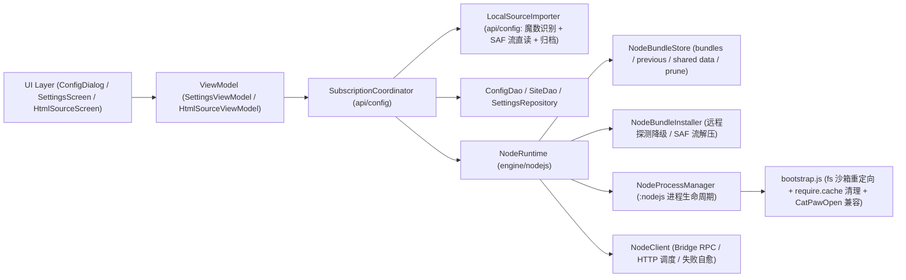

# MewBox 订阅配置与加载重构优化计划

> 状态：**已完成重构落地与验证**（2026-11-18，已完成代码重构、`bootstrap.js` 加固、`assembleDebug` 与单元测试回归）
> 范围：`app/src/main/assets/nodejs/`、`com.fongmi.nodejs`、`com.mewbox.tv.engine.nodejs`、`com.mewbox.tv.api.config`、`com.mewbox.tv.ui.setting`、`com.mewbox.tv.ui.web.fm`
> 基准与参考：现行架构文档 [nodejs-source-architecture.md](./nodejs-source-architecture.md)、架构准则 [code.md](../.agents/rules/code.md)、配套源项目 `D:\project\CatPawOpen\nodejs`，以及对照分析过的两款同类播放器 **Arcane** 与 **uzn**。

---

## 一、现状问题诊断（基于当前代码）

结合当前仓库源码审视，订阅配置与本地包加载「混乱、臃肿、难维护」的根因集中在以下 5 个方面：

1. **核心类职责严重膨胀（God Class）**：
   - [NodeBundle.kt](../app/src/main/java/com/fongmi/nodejs/NodeBundle.kt)（937 行）：同时承担入口 URL 识别、会话取消、OkHttp 并发探测、远端下载、`file://` 读取、ZIP 解压与扁平化、MD5 / `index.manifest.json` 验签、`staging/active/previous` 原子提交与回滚、旧版 `db.json/profile.json` 迁移、孤儿清理 `prune`。
   - [NodeClient.kt](../app/src/main/java/com/fongmi/nodejs/NodeClient.kt)（885 行）：同时承担 `:nodejs` 跨进程绑定与 `DeathRecipient`、`active_source` 文本文件持久化、`profile.json` 读写、`LocalMessageBridge` 桥接分发、HTTP 路由超时管理与异常自动重启恢复。
   - [VodConfig.kt](../app/src/main/java/com/mewbox/tv/api/config/VodConfig.kt)（590 行）：混合订阅分流路由、本地 `content://` / `file://` 读取、HTML 网页推送底座静默准备、Site 表合并与首页锁定、冷启动刷新与降级。

2. **本地包权限前置拦截与中间冗余拷贝**：
   - [AndroidManifest.xml](../app/src/main/AndroidManifest.xml) 第 9 行声明了 `MANAGE_EXTERNAL_STORAGE`；[ConfigDialog.kt](../app/src/main/java/com/mewbox/tv/ui/setting/ConfigDialog.kt) 第 112~119 行在调用系统 SAF `ActivityResultContracts.OpenDocument()` 前强检该权限，未授权会直接打断流程并跳转系统设置（实际上 `uzn` 与 Arcane 均通过 SAF 直读所选文档流，无需此重权限）。
   - [FilePickerHelper.kt](../app/src/main/java/com/mewbox/tv/ui/setting/FilePickerHelper.kt) 第 96~130 行在 **UI 回调内同步拷贝** 文件到 `filesDir/subscriptions/<原文件名>` 并伪造 `file://` 路径塞入输入框：同名文件静默覆盖、Node ZIP 占用双份存储（`subscriptions/*.zip` + `nodejs/bundles/<sha256>/active/`）、拷贝失败兜底返回 `content://` 时又被 `NodeBundle.isConfig` 明确拒收。

3. **ViewModel 重复逻辑与孤儿清理断链**：
   - [SettingsViewModel.kt](../app/src/main/java/com/mewbox/tv/ui/setting/SettingsViewModel.kt)（`saveConfig` / `deleteConfig`，第 162~204 行）与 [HtmlSourceViewModel.kt](../app/src/main/java/com/mewbox/tv/ui/web/fm/HtmlSourceViewModel.kt)（第 144~211 行）逻辑高度重复。
   - `NodeBundle.prune`（第 851~866 行）在全项目**零调用**；删除订阅时仅删 Room 的 `Config` 与 `History`，遗留大量 `nodejs/bundles/<sha256>` 与 `filesDir/subscriptions/` 孤儿文件。

4. **配置校验过严与 `previous` 回滚闭环不完整**：
   - 远程订阅探测 `NodeBundle.probe`（第 257~292 行）强要求 `index.config.js.md5` 非空且完全匹配（第 219 行）；一旦源作者漏更配置 `.md5` 即直接阻断启动。
   - 本地 ZIP 仅探测单层子目录（`flattenSingleSubdirectoryIfPresent`，第 814~828 行）；且 URL 仅认 `index.js.md5` 或 `.zip`，不像 Arcane 支持直接填 `index.js` 自动推导出伴生 `index.js.md5`。
   - `NodeBundle.restorePrevious`（第 541~550 行）只在 `active` 文件缺失时触发；若新包通过了 MD5 校验提交到 `active`（带 `.pending`），但 `NodeService` 运行期加载或 `/config` 崩溃，冷启动 `ensureStarted()` 并不会据此自动退回 `previous`。

5. **Node 引导层缺少路径沙箱、缓存清理与单一状态真相源**：
   - [bootstrap.js](../app/src/main/assets/nodejs/bootstrap.js)（第 156~164 行）直接 `require(configPath)` 与 `require(indexPath)`，未清 `require.cache`，无空 `{}` config 保底（即使配套 `CatPawOpen/nodejs/src/index.js` 第 30~34 行已支持 `defaultConfig`）；且缺少像 `uzn` `d.cjs` 那样的 `fs` 越界访问重定向保护，遇到第三方脚本写 `/tmp` 等外部路径时会直接报错崩溃。
   - **活跃源三头存储**：`SettingsRepository`（DataStore）、`ConfigDao`（Room）与 `NodeClient.active_source`（第 190~207 行私有文本文件）各自持久化当前订阅，易出现不同步。

---

## 二、借鉴取舍矩阵（Arcane vs uzn vs MewBox）

| 能力维度 | Arcane 做法 | uzn 做法 | MewBox 重构采纳结论 |
| :--- | :--- | :--- | :--- |
| **本地选文件权限** | `OpenSdCardDocument` 直开 SD 卡根目录，无需前置权限 | 走改造 SAF，**无** `MANAGE_EXTERNAL_STORAGE` | **采纳**：选文件直接拉起 SAF；取消点选前强要所有文件权限 |
| **本地包落盘与标识** | 按类型分流，`Uri` 流式读入私有目录 + 虚拟标识与文件名分离 | `local-zip://` 落盘，编辑支持选新 ZIP 覆盖 | **采纳**：SAF 流直解至 `nodejs/bundles/`，采用 `local://node/<id>` + 原位覆盖替换；私有 JSON/HTML 按 `config.id` 归档 |
| **URL 入口兼容** | `NodePackagesKt` 同时支持 `index.js` 与 `index.js.md5` | 支持 `index.js.md5` 与远端云端直连 | **采纳前端入口部分**：同时支持 `index.js`、`index.js.md5`、远程/本地 `.zip`；**不引入**云端直连服务与复杂弹幕服务调度 |
| **配置与网络降级** | 校验失败或超时降级复旧包，支持坏包恢复 `.backup` | `index.config.js` MD5 不匹配/下载失败容忍按空 `{}` 启动；更新超时本地启动 | **采纳**：核心 `index.js` 严格验 MD5；`index.config.js(.md5)` 缺失/不匹配降级复用本地旧配置或 `{}` 启动并记警告；冷启动/切换失败利用 `.pending` 自动退回 `previous` |
| **Node 运行时隔离** | 单源单目录，运行态按包目录切分并靠迁移合并 | `worker_threads` 多实例 + `d.cjs` 透明 `fs` 越界重定向至 `Temp/_redirect` | **折中采纳**：**保留** `:nodejs` 独立进程 + **保留**全局共享 `nodejs/data`（切换包自动保留网盘 Cookie）；仅引入 `d.cjs` 的轻量 `fs` 越界重定向 + `require.cache` 清理 |
| **垃圾清理 & 残留清扫** | 删除订阅联动删除对应包与历史 | 卸载等 Worker 退出后 `purge` 数据目录 + 启动清扫残留临时目录 | **采纳**：删/换订阅联动 `NodeBundleStore.prune` 与私有文档清理；启动时异步清理孤儿 `staging-*` / `.downloads` / 旧 `subscriptions/` |
| **重型外围特性** | `NanoHTTPD` 本地目录挂载、WebDAV 全包同步、Python/Spider 多引擎 | 订阅锁、WebDAV 多端同步、加密备份、持久 `safHandle` | **全部舍弃**：严格克制，维持个人纯正 Node.js 播放器（+ 现有 T4 / HTML 网页兼容）的轻量化边界 |

---

## 三、目标架构与目录规范

严格遵守 [code.md](../.agents/rules/code.md) 单向依赖约束（`ui -> domain/viewModel -> api/engine/db -> bean`，`engine/nodejs` 不反向依赖 `ui`/`domain`/`player`）：

### 数据与目录布局规范
1. **私有 Node 包存储布局（保留现有强项，清理中间冗余）**：
   - `filesDir/nodejs/data/`：**全局共享**（保留 `db.json`，确保切换任何 Node 包都不丢网盘 Cookie）。
   - `filesDir/nodejs/profile.json`：全局共享扩展配置。
   - `filesDir/nodejs/bundles/<bundleKey>/`（`<bundleKey>` 由 `sha256(url)` 计算，其中本地 ZIP 包固定使用 `local://node/<configId>` 计算）：
     - `active/`：当前激活包（`index.js`、`index.config.js`、`index.js.md5`、`index.config.js.md5`、可选 `index.manifest.json`、`Temp/` 运行重定向目录、`Temp/_redirect/`、`PENDING` 标记）。
     - `previous/`：上一个已验证启动成功的稳定版本，供回滚兜底。
     - `staging-<uuid>/` & `.downloads/`：临时暂存区（启动/清扫时清除孤儿）。
2. **非 Node 本地订阅归档目录（替代无序的 `filesDir/subscriptions/`）**：
   - `filesDir/local_configs/<configId>.json`：本地导入的普通 TVBox/T4 JSON 配置，规范地址 `local://vod/<configId>`。
   - `filesDir/local_html/<configId>.html`：本地导入的网页源，WebView 直接加载私有目录文件，规范地址 `local://html/<configId>`（同时保留对用户手输物理路径 `file:///.../*.html` 的直读兼容）。
3. **移除冗余 `filesDir/nodejs/active_source` 文件**：
   - 统一以 `SettingsRepository`（`config_url` / `config_id`）+ `ConfigDao` 作为订阅唯一真相源；`NodeClient.restoreBundle()` 若未传入 `source` 时，由上层协调器显式传递或回退 `NodeBundleStore.restoreLatest()`。

---

## 四、分阶段实施清单

### Phase 1：权限瘦身与 SAF 选择流理顺（UI + Helper）
- **改动文件**：
  - [AndroidManifest.xml](../app/src/main/AndroidManifest.xml)
  - [FilePickerHelper.kt](../app/src/main/java/com/mewbox/tv/ui/setting/FilePickerHelper.kt)
  - [ConfigDialog.kt](../app/src/main/java/com/mewbox/tv/ui/setting/ConfigDialog.kt)
- **具体内容**：
  1. 在 `ConfigDialog` 点击本地文件图标时，**直接调起系统文件选择器**（使用 `ActivityResultContracts.OpenDocument` 并附加 `INITIAL_URI` 指向内部存储根，传入 `arrayOf("*/*")`），彻底取消选前检查与跳转系统权限设置页的阻塞逻辑。
  2. 移除 `FilePickerHelper.resolveLocalFilePath()` 中在主线程拷贝文件到 `filesDir/subscriptions/` 的逻辑；`FilePickerHelper` 仅保留轻量的显示名读取（`getFileName`）与 `INITIAL_URI` 构造。
  3. 重构 `ConfigDialog` 回调模型，区分「输入 URL / JSON 文本」与「SAF 选中的本地文件 `PickedFile(uri, displayName)`」：选中本地文件后，输入框仅展示可读名称/状态，避免暴露内部 `file:///data/...` 路径；编辑本地源时支持重新选包覆盖替换。
  4. **权限策略清理（见 §6 #1）**：移除 `ConfigDialog` 的前置 `MANAGE_EXTERNAL_STORAGE` 检查及 `FilePickerHelper` 内强求存储权限分支。

### Phase 2：`NodeBundle` 拆解重构与校验/降级升级（引擎存储与安装层）
- **改动文件**：将 [NodeBundle.kt](../app/src/main/java/com/fongmi/nodejs/NodeBundle.kt)（937 行）拆分为职责单一、控制在合理长度的高内聚模块：
  - `NodeSourceLocator.kt`：源地址解析与分类（支持 `http(s)://.../index.js`、`.../index.js.md5`、`.../xxx.zip`、`local://node/<id>`、`file://.../*.zip`；对于不带 `.md5` 的 `.../index.js` 自动推导伴生 `index.js.md5`）。
  - `NodeBundleStore.kt`：管理 `nodejs/data`、`nodejs/profile.json`、`nodejs/bundles/<key>` 的目录读写、原子 `commit(active, staging)`、`.pending` 标记管理、`rollbackToPrevious(active)`、旧版目录迁移、`prune(validKeys)` 与启动孤儿清扫（含清理历史遗留 `filesDir/subscriptions/` 中无引用的旧包）。
  - `NodeBundleInstaller.kt`：实现远程与流式两种安装路径：
    - `installRemote(...)`：并发探测 sidecar（延续 3s 短超时 `PROBE_CLIENT`），网络超时/失败自动复用已缓存 `stored`；`index.js` 强校验 MD5；**参考 `uzn` 放宽 `index.config.js`**：若 `index.config.js.md5` 缺失、不匹配或 `index.config.js` 下载失败，不再直接阻断启动，优先沿用旧 `stored.config`（若无旧包则生成空导出模块 `module.exports = {};` 写入并记 `Timber.w` 告警）；可选 [NodeManifest.kt](../app/src/main/java/com/fongmi/nodejs/NodeManifest.kt) 保持兼容，仅在远端/压缩包提供签名或已锁定 `trusted-key.sha256` 时校验。
    - `installFromZipStream(...)`：直接接收 SAF `InputStream` 或本地/远程 ZIP `File` 流式解压到 `staging`（延续 64MB 解压上限与 Zip-Slip 路径越界检查），并将根目录自动探测放宽至最多 3 层嵌套目录查找 `index.js`；校验并原子提交至 `active`。
  - 保留轻薄门面类 `NodeBundle`（持有 `root` / `index` / `config` / `data` / `indexMd5` / `configMd5` / `pending` 与 `accept()` / `isSameVersion()`），保持上层与现有测试语义清晰。

### Phase 3：`NodeClient` 瘦身、`previous` 闭环回滚与订阅协调层去重
- **改动文件**：
  - [NodeClient.kt](../app/src/main/java/com/fongmi/nodejs/NodeClient.kt) 拆分出 `NodeProcessManager.kt`（专注 `NodeService` `ServiceConnection`、死亡监听、启停与超时）与精简后的 `NodeClient`（专注 Bridge 消息队列、`profile.json`、`/config` 与爬虫接口转发 + 重放初始化）。
  - 移除 `NodeClient` 内 `saveActiveSource` / `readActiveSource` 冗余文件读写。
  - **补全坏包自动回滚安全网**：在 `NodeClient.load()` 与 `ensureStarted()` 中，若目标 `NodeBundle.pending == true` 且在 `start()` 或紧接的 `GET /config` + `NodeConfigMapper.transform` 阶段抛出非取消异常：
    - 若存在可用 `previous`，自动执行 `store.rollbackToPrevious(bundle)` 并用稳定旧包重新启动与重试 `/config`，完成后上报「新包启动异常，已回滚至上一可用版本」；仅当连 `previous` 也不可用时才 `clearRuntime()` 并向上报错。
  - 新增 `LocalConfigImporter.kt` 与 `SubscriptionCoordinator.kt`（`api/config/`，拆分并精简 [VodConfig.kt](../app/src/main/java/com/mewbox/tv/api/config/VodConfig.kt)）：
    - `LocalConfigImporter` 负责对本地 SAF `Uri` 走字节头嗅探（`PK\x03\x04` → ZIP 走 `NodeBundleInstaller.installFromZipStream`、否则流式读文本按 `ResultParser.parseSites` 与 `isHtmlResponse` 区分 JSON / HTML），统一以 `config.id` 稳定生成 `local://node/<id>` / `local://vod/<id>` / `local://html/<id>`；支持**原位覆盖替换**（保留 `Config.id`，从而保留播放历史、选集偏好与 `previous` 回滚链）。
    - `SubscriptionCoordinator` 收口**保存/改名/切换/删除**逻辑，供 `SettingsViewModel` 与 `HtmlSourceViewModel` 共用，消除重复代码；并在 `deleteConfig` 和导入替换成功后联动清理对应私有文件与调用 `NodeBundleStore.prune`。

### Phase 4：Node 侧引导脚本沙箱与 `CatPawOpen` 深度适配（`bootstrap.js`）
- **改动文件**：[bootstrap.js](../app/src/main/assets/nodejs/bootstrap.js)、[NodeService.kt](../app/src/main/java/com/fongmi/nodejs/NodeService.kt)
- **具体内容**：
  1. **`require.cache` 清理与配置容错**：加载 `configPath` / `indexPath` 前清理 `require.cache`，且当 `configPath` 缺失或 `require` 异常时降级传入 `{}`（确保配套 `CatPawOpen/nodejs/src/index.js` 可回退 `defaultConfig` 启动）。
  2. **轻量 `fs` / `fs/promises` 越界重定向沙箱（借鉴 `uzn` `d.cjs`）**：
     - 保持 `dataRoot`（含 `CatPawOpen` 依赖的 `NODE_PATH/db.json`）**读写全放行**；
     - 保持 `bundleRoot`（含 `t4.js` 等可能读取的同目录配置文件）**只读放行**；
     - 为当前 bundle 建立工作临时目录 `bundleTempDir`（即 `bundleRoot/Temp`），将企图读写白名单之外路径（例如第三方脚本硬编码 `/tmp`、越界相对路径）的 `fs` / `fs/promises` 调用，通过路径规范化透明重定向到 `bundleTempDir/_redirect/...`，同时不干扰 `dataRoot` 共享 Cookie 读写。
  3. **异常日志过滤**：对 `unhandledRejection` 过滤 `/WebAssembly|undici|llhttp/` 等无关噪音警告。

### Phase 5：数据模型检查、冷启动时序优化与完整回归验证
- **数据库兼容性确认**：若采用 `local://node/<id>` + `MIGRATION_8_9` 增加展示名称列（或将默认文件名写入 `name` / URL 参数，见 §6 #3），同步完善 `ConfigDao` 与测试；应用冷启动后在后台异步执行一次 `NodeBundleStore.prune` 与旧 `filesDir/subscriptions/` 无主文件清理。
- **冷启动时序**：保持 `VodConfig.ensureActiveConfig` 仅对非本地包联网探测更新的简洁机制（`local://node/*` 启动时跳过网络探测直接秒启）；远程探测超限/失败时使用本地缓存启动并给出简明 Toast。

---

## 五、验证计划

1. **现有单元回归套件**（每阶段完成后运行 `./gradlew testDebugUnitTest`）：
   - [LocalSubscriptionTest.kt](../app/src/test/java/com/mewbox/tv/LocalSubscriptionTest.kt)
   - [NodeBundleZipTest.kt](../app/src/test/java/com/mewbox/tv/NodeBundleZipTest.kt)
   - [NodeBundleRollbackTest.kt](../app/src/test/java/com/mewbox/tv/NodeBundleRollbackTest.kt)
   - [NodeEngineTest.kt](../app/src/test/java/com/mewbox/tv/NodeEngineTest.kt)
   - [HomeStartupCoordinationTest.kt](../app/src/test/java/com/mewbox/tv/HomeStartupCoordinationTest.kt)
   - [HtmlSourceTest.kt](../app/src/test/java/com/mewbox/tv/HtmlSourceTest.kt)
2. **新增核心单元测试**：
   - `NodeSourceLocatorTest`：校验 `index.js`、`index.js.md5`、`.zip`、`local://node/<id>` 解析与 `content://` 处理。
   - `NodeBundleInstallerTest`（MockWebServer + 临时 ZIP 流）：覆盖 SAF `InputStream` 流式直解（多层级目录）、远程 `index.config.js.md5` 缺失/不匹配时的降级放行、原位覆盖保留 `previous` 与共享 `nodejs/data/db.json`、删除订阅后 `prune` 清理。
   - `NodeRollbackIntegrationTest`：模拟新包 MD5 正确但运行 `start()` 或 `/config` 报错（携带 `.pending`），验证自动触发回滚 `previous` 并拉起成功。
   - `bootstrap.js` 桌面端 Node 回归脚本：验证 `fs` / `fs/promises` 白名单放行（`dataRoot` 可读写、`bundleRoot` 只读）与越界写入重定向至 `Temp/_redirect`，并实测 `D:\project\CatPawOpen\nodejs\dist` 产物可正常启动与读写 `db.json`。
3. **模拟器实机端到端验证**：
   - 无存储权限直选本地 `CatPawOpen` ZIP 导入 → 首页加载与网盘 Cookie 写入 → 长按编辑「替换本地包」验证保留历史与 Cookie → 导入损坏 ZIP 验证自动回滚旧包 → 切换远程 `index.js` / `index.js.md5` 订阅 → 删除订阅检查私有目录清理干净。

---

## 六、已确认决策记录

1. **`MANAGE_EXTERNAL_STORAGE` 权限策略（已确认）**：**彻底从清单及代码移除** `MANAGE_EXTERNAL_STORAGE` 及前置权限拦截，所有本地订阅均走系统 SAF 选择器直读导入私有目录。
2. **本地 ZIP 缺 `index.config.js` 的处理标准（已确认）**：本地 ZIP 包**维持必须同时包含 `index.js` 与 `index.config.js`**；仅对**远程源**的 `index.config.js(.md5)` 缺失/校验异常做降级（沿用本地旧配置或空 `{}` 启动）并打警告日志。
3. **Room `Config` 表结构（已确认）**：**保持数据库零迁移**（维持 `AppDatabase version = 8`），导入本地文件时将默认文件名写入 `Config.name`。
