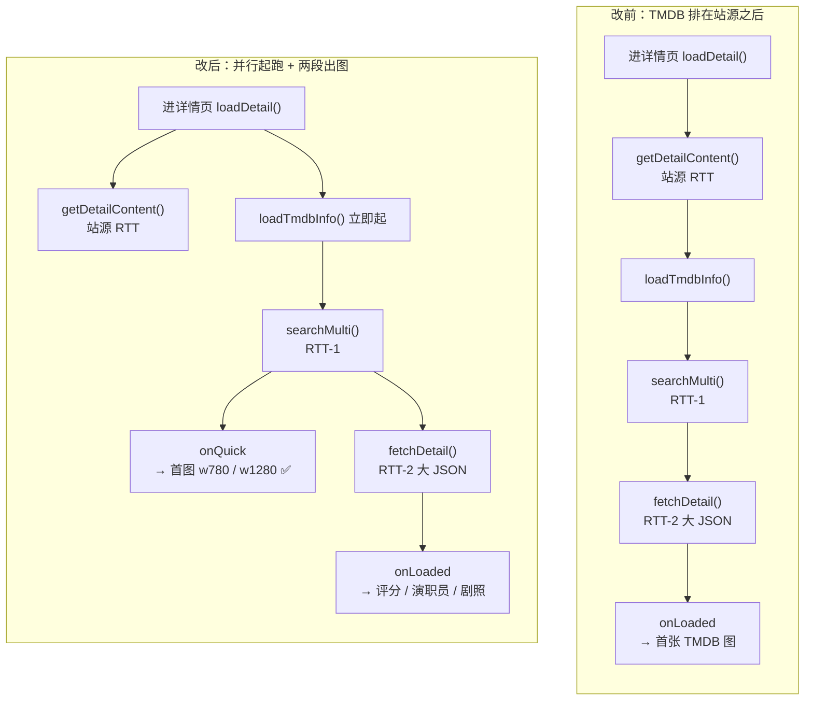

# 详情页 TMDB 海报首图提速计划（借鉴 wogg）

> 状态：已实施（2026-11-11 修正落地并验证完成）
> 范围：仅优化「详情页 TMDB 海报 / 背景出图时机与容错」，**不重构 TMDB 缓存层、不改站源解析与播放链路、不动列表页数据模型（P1 结果写回除外）**。
> 参考来源：`quickjs/wogg.html`（单文件 Web 应用）的 TMDB 加载链路分析；本计划只借其**时序与出图策略**。

---

## 一、背景与问题

### 1.1 wogg 为什么"秒出"

核心不是接口变快，而是三件事：

1. **TMDB 完全不进首屏关键路径** —— 首屏同步渲染站源图/占位，TMDB 在后台空闲帧跑；
2. **一次匹配、全页复用** —— 缓存 Promise（而非结果）做并发去重，`search/multi` 结果写回条目对象，海报 / logo / 剧照 / 详情共用；
3. **两段式出图** —— 列表阶段只打 `search/multi`，用其自带的 `poster_path / backdrop_path` 先出小图；详情大 JSON 放后台补元数据。

### 1.2 MewBox 现状时序

```
进详情页 loadDetail()
  └─ repository.getDetailContent()          [站源 RTT]
       ├─ 更新 vod / 历史 / 播放会话
       └─ tmdbCoordinator.loadTmdbInfo()    ← 到这里才起 TMDB（DetailViewModel.kt:226）
            ├─ getTmdbConfig()              [DataStore 读 #1，Coordinator:32]
            ├─ searchMulti()                [RTT-1，getTmdbConfig 读 #2，Client:120]
            ├─ fetchDetail()                [RTT-2 大 JSON，getTmdbConfig 读 #3，Client:158]
            └─ onLoaded → 更新 state → 重算 backdropUrl / detailPosterUrls
```

**首张 TMDB 图 = 站源详情 RTT + 配置读 + 两次串行 API + 一次全量大 JSON 解析。** 在 TMDB 回来前，背景只有 `state.vod?.vodPic`（`DetailScreen.kt:152-154`）；若站源图为空，就是纯色占位。

### 1.3 根因清单

| # | 现象 / 根因 | 代码位置 |
| -- | ----------- | -------- |
| 1 | TMDB 排在站源详情**之后**串行启动，白白多等一个站源 RTT | `DetailViewModel.kt:169 → 226`；跨源成功分支同样在 `:264` |
| 2 | `searchMulti` → `fetchDetail` **串行两次请求**，且首图依赖第二次的完整大 JSON | `DetailTmdbCoordinator.kt:46-54` |
| 3 | `fetchDetail` 挂 `credits,images,recommendations,similar`，响应体大、解析慢；`readTimeout = 20s` | `TmdbClient.kt:167`、`:31` |
| 4 | 同一次链路读 DataStore **3 次**（`getTmdbConfig()` 每次 `.first()`） | `TmdbRepository.kt:39`；`Coordinator:32` / `Client:120` / `Client:158` |
| 5 | `detailPosterUrls` 把 `images.backdrops` **全部 w1280** + `images.posters` **全部 w780** + 站源图一次性塞进 Pager，5s 自动轮播 | `DetailHero.kt:337-363`、`:93`、`:226-234` |
| 6 | 图片加载失败直接退化占位，无备用域名、无预加载、无 crossfade | `DetailHero.kt:399-409`、`PosterBackdrop.kt:46-47` |
| 7 | 缓存 key 只有清洗标题，无年份/季；匹配只看相似度 + 热度，翻拍片易串图 | `TmdbCache.kt:47-49`、`TmdbClient.kt:307-329` |
| 8 | 列表 / 首页完全不碰 TMDB（全项目仅 2 处 `loadTmdbInfo` 调用），详情每次冷起都要重新匹配 | `DetailViewModel.kt:226`、`:264` |

### 1.4 已具备、**明确不改** 的部分

> 这一节是核对代码后对初版分析的修正，别把下面几条当"待优化"写进任务。

| 项 | 现状 | 结论 |
| -- | ---- | ---- |
| API 域名 | `DEFAULT_API_BASE = "https://api.tmdb.org"`（`TmdbClient.kt:189`） | **wogg 的域名优化 MewBox 早已具备**，无需改动 |
| 图片 CDN | `DEFAULT_IMAGE_BASE = "https://image.tmdb.org/t/p"`（`:190`），支持自定义代理与 `normalizeImageBase` | 保持现状，P1 的双域名回退需**基于用户配置**而非硬编码覆盖 |
| 鉴权 | Bearer Token / API Key 双模式（`TmdbClient.kt:266-274`） | 比 wogg 明文 key 强，保持 |
| 缓存层 | `LruCache<String, TmdbDetail>(50)` + **7 天磁盘负缓存** + **手动修正持久化**（`TmdbCache.kt`） | **比 wogg 的无上限、无 TTL、刷新即丢的内存 Map 完善**，不重构 |
| 止损 | 负缓存跳过（`Coordinator:44`）、异常 catch（`:58`） | 保留，P2 只补超时/熔断 |
| 图片缓存 | Coil3 自带内存 + 磁盘缓存 | 不引入新图片库 |

### 1.5 决策记录

- **只借时序、两段出图、图片容错**；缓存层、网络层、鉴权层保持现状。
- **P0 收敛在 4 个文件**（`DetailUiState` / `DetailTmdbCoordinator` / `DetailViewModel` / `DetailScreen` + `DetailHero` 参数），可独立编译、独立验收、独立回滚。
- **两段式出图的数据来源已具备**：`TmdbMedia` 已含 `posterPath / backdropPath`（`TmdbModels.kt:24-25`），`pickBestMatch` 返回的就是 `TmdbMedia`，无需新增接口。
- **不做**列表页预取作为 P0：需动 `Vod` 模型与列表性能评估，放到 P1 且标记可选。
- **排序所需字段当前缺失**：`TmdbImageItem` 只有 `filePath / voteAverage`（`TmdbModels.kt:59-62`），无 `iso_639_1 / width / height / aspect_ratio` → P1 步骤 5 必须先扩展 bean，否则「按无字/竖版排序」落不了地。

---

## 二、目标效果



| 指标 | 改前 | 目标 |
| ---- | ---- | ---- |
| 首图依赖链路 | 站源详情 RTT + 2 次串行 API + 大 JSON | 仅 1 次 `searchMulti`（与站源详情并行） |
| 首图依赖请求数 | 2 次 API | 1 次 API |
| TMDB 未回来时的背景 | `vodPic` 或纯色占位 | 同上 + 站源详情未回时 quick 图可先行铺底 |
| 轮播首屏图片量 | 全部 backdrops + posters（可达数十张） | ≤ 5 张，首图小尺寸优先 |
| 图片失败 | 直接占位 | 备用域名回退 + crossfade |
| 弱网首图止损 | 最长 20s 且无熔断 | quick 段 3s 超时 + 连续失败熔断 |

---

## 三、实施步骤

### 阶段一 · P0（首图提速，独立可交付）

#### 步骤 1：`DetailUiState` 增加 quick 字段

修改 `ui/detail/DetailUiState.kt:32-33` 附近，新增两个字段：

```kotlin
val tmdbDetail: TmdbDetail? = null,
val tmdbImageBase: String = "",
/** searchMulti 命中即回填，不等 fetchDetail */
val quickPoster: String? = null,
val quickBackdrop: String? = null,
```

`tmdbJob: Job?` 放在 `DetailViewModel` 私有字段，不进 UiState。

#### 步骤 2：`DetailTmdbCoordinator` 拆成两段回调

改 `loadTmdbInfo` 签名为带默认值的可选 `onQuick`，两个现有调用点可平滑升级：

```kotlin
fun loadTmdbInfo(
    scope: CoroutineScope,
    vodName: String,
    onLoaded: (detail: TmdbDetail, imageBase: String) -> Unit,
    onQuick: ((poster: String?, backdrop: String?) -> Unit)? = null,
) {
    scope.launch {
        try {
            val config = tmdbRepository.getTmdbConfig()
            if (!config.enable || config.apiKey.isBlank()) return@launch

            val cleaned = TmdbClient.cleanTitle(vodName)
            if (cleaned.isBlank()) return@launch

            val cached = tmdbCache.getDetailByTitle(cleaned)
            if (cached != null) {
                // 缓存命中：直接给完整结果，quick 用 detail 自身字段反推，避免二次替换
                onQuick?.invoke(
                    TmdbClient.imageUrl(config.imageBase, cached.posterPath, "w780").ifEmpty { null },
                    TmdbClient.imageUrl(config.imageBase, cached.backdropPath, "w1280").ifEmpty { null },
                )
                onLoaded(cached, config.imageBase)
                return@launch
            }

            if (tmdbCache.isNegative(cleaned)) return@launch

            // 第一段：searchMulti 一到就出图，不等大 JSON
            val searchRes = tmdbClient.searchMulti(cleaned).getOrNull()
            val best = TmdbClient.pickBestMatch(cleaned, searchRes)
            if (best == null) {
                tmdbCache.markNegative(cleaned)
                return@launch
            }
            onQuick?.invoke(
                TmdbClient.imageUrl(config.imageBase, best.posterPath, "w780").ifEmpty { null },
                TmdbClient.imageUrl(config.imageBase, best.backdropPath, "w1280").ifEmpty { null },
            )

            // 第二段：后台补 logo / 评分 / 演职员 / 剧照
            val detail = tmdbClient.fetchDetail(best.mediaType, best.id).getOrNull()
            if (detail != null) {
                tmdbCache.putDetailByTitle(cleaned, detail)
                tmdbCache.putDetail(best.mediaType, best.id, detail)
                onLoaded(detail, config.imageBase)
            }
        } catch (e: Exception) {
            Timber.w(e, "获取 TMDB 增强信息失败: $vodName")
        }
    }
}
```

> 要点：`onQuick` 与 `onLoaded` 顺序独立，**第二段失败不影响已出的首图**（现状会整条链路退回站源图）。`applyTmdbMatch` / `searchTmdb`（弹窗搜索）不改。

#### 步骤 3：`DetailViewModel` 提前起 TMDB，与站源详情并行

**起跑点选在 `DetailViewModel.kt:136` 之后、`139` 的 action 分支之前**——一处起跑覆盖三个分支（常规源 / `msearch` 跨源 / 动作类提前 return 前可跳过）：

```kotlin
_uiState.update { it.copy(currentSite = site) }

// P0：用入口已知的片名立即起 TMDB，与站源详情并行
val kickoffName = fallbackVodName.ifBlank { initialVodName }
if (kickoffName.isNotBlank() && !Vod.isActionId(vodId)) {
    tmdbJob?.cancel()
    tmdbJob = tmdbCoordinator.loadTmdbInfoStaged(
        scope = viewModelScope,
        vodName = kickoffName,
        onQuick = { poster, backdrop ->
            _uiState.update { it.copy(quickPoster = poster, quickBackdrop = backdrop) }
        },
        onLoaded = { detail, imageBase ->
            _uiState.update { it.copy(tmdbDetail = detail, tmdbImageBase = imageBase) }
        },
    )
}
```

需要处理的三个分支细节：

| 分支 | 处理 |
| ---- | ---- |
| 常规源（`:168-241`） | 站源详情回来后（`:215` 之后），若 `TmdbClient.cleanTitle(vod.vodName) != cleanTitle(kickoffName)` → `tmdbJob?.cancel()` 并按真实 `vodName` 重起一次，**避免用错片名串图**；相同则保留已起链路，删掉原 `:226` 调用 |
| `msearch`（`:147-166`） | 该分支 `:164` 直接 `return@launch`，但 `targetName` 正是 `fallbackVodName`，上面的起跑已覆盖；跨源成功后 `:264` 若 `validVod.vodName` 与起跑名不同，同样取消重起 |
| 动作类（`:139-144`） | 用 `!Vod.isActionId(vodId)` 跳过，不产生无意义请求 |

> 建议 `loadTmdbInfoStaged` 返回 `Job`（`scope.launch { ... }` 的返回值），便于取消；或把步骤 2 的函数签名改为 `fun ...: Job`。取消时 `OkHttp` 调用会被协程中断，无需额外处理。

#### 步骤 4：`DetailScreen` / `DetailHero` 消费 quick 图

`DetailScreen.kt:150-154`：

```kotlin
val backdropUrl = state.quickBackdrop
    ?: state.tmdbDetail?.backdropPath?.let {
        TmdbClient.imageUrl(state.tmdbImageBase, it, "w1280")
    }
    ?: state.vod?.vodPic
```

- `quickBackdrop` 不依赖 `state.vod`，**站源详情未回来时也能先铺底**，这是提前起跑的主要收益。
- `backdropSeed` 的 `remember` + `LaunchedEffect`（`:156-168`）已能平滑过渡种子色，保持不动，避免跳回默认蓝。

`DetailHero.kt:337` `detailPosterUrls` 增加 `quickPoster` 参数并置于首项；`:218-220` 的 `remember` key 同步加上：

```kotlin
internal fun detailPosterUrls(
    vod: Vod,
    tmdbDetail: TmdbDetail?,
    tmdbImageBase: String,
    quickPoster: String? = null,
): List<String> {
    val list = mutableListOf<String>()
    quickPoster?.let { list.add(it) }
    // ... 原有 backdrops / posters / vodPic 逻辑不变
    return list.distinct()   // quick 与后续图重复时自动去重
}
```

`DetailScreen.kt:288-289` 传参处补 `quickPoster = state.quickPoster`。

> `AsyncImage` 的 `crossfade` 放到步骤 7（P1）统一做，P0 先保证时序收益可测。

---

### 阶段二 · P1（体验与稳健性）

#### 步骤 5：轮播限量 + 排序 + 渐进尺寸

**前置改动**：`TmdbModels.kt:59-62` 给 `TmdbImageItem` 补字段（`@SerialName` 对齐 TMDB `/images` 响应）：

```kotlin
@Serializable
data class TmdbImageItem(
    @SerialName("file_path") val filePath: String? = null,
    @SerialName("vote_average") val voteAverage: Double = 0.0,
    @SerialName("iso_639_1") val iso639: String? = null,
    @SerialName("width") val width: Int = 0,
    @SerialName("height") val height: Int = 0,
    @SerialName("aspect_ratio") val aspectRatio: Double = 0.0,
)
```

`detailPosterUrls` 排序后限量：

| 规则 | 说明 |
| ---- | ---- |
| 排序 | 无字（`iso639 == null`）优先 → 横版（`aspectRatio > 1`）优先 → `voteAverage` 降序 |
| 限量 | `backdrops.take(4)` + `posters.take(2)`，总URL ≤ 5（含 quick 与站源图），保留 `distinct()` |
| 尺寸 | 首图 w780，其余 w1280；高清替换由 Coil 缓存命中后自然完成，不做强制二次请求 |
| 轮播 | `HERO_ROLL_INTERVAL_MS`（`DetailHero.kt:93`）保持 5s，但 `pagerState` 的 `pageCount` 随限量下降，避免几十页 |

#### 步骤 6：结果写回条目对象（**可选，改动面大**）

对应 wogg 的 `_tmdbPoster / _tmdbFull`：

- 在 `Models.kt:21` 的 `Vod` 增加带默认值的字段（或改用独立的 `TmdbQuickCache` 单例 Map，避免污染 data class 的 `copy/equals`），存放 `quickPoster / quickBackdrop` 及其来源 `cleanedTitle`；
- 列表 / 首页卡片可见时（`LazyGrid` 的 `LaunchedEffect` + 可见性判断）预取匹配，限量并发（建议 3～5 路，参照 wogg 的 5 路池）；
- 详情入口先读挂载结果，命中即 0 请求秒出。

> **建议先不做**：MewBox 已有 7 天负缓存与标题缓存，重复进详情的收益有限；而列表预取会显著增加请求量与 TV 端解码压力。等步骤 9 埋点证明「`searchMulti` 是主要耗时」后再决定是否实施。

#### 步骤 7：图片容错

| 落点 | 改法 |
| ---- | ---- |
| `DetailHero.kt:399-409` | `onState == Error` 不立即置 `isError`，先切备用域名重试一次；两次都失败才 `PosterPlaceholder` |
| `PosterBackdrop.kt:46-47` | 同上，`loadFailed` 前插入一次回退 |
| 双域名 | `image.tmdb.org` ↔ `images.tmdb.org`。**必须基于 `state.tmdbImageBase` 做字符串替换**：仅当用户未自定义代理（base 为官方默认值）时才启用；用户配了代理就直接用代理，不要覆盖 |
| 预加载 + 过渡 | 用 Coil3 `ImageLoader` 预取，成功后才换 `model`；`ImageRequest.Builder.crossfade(true)` 或 `AnimatedContent` 淡入，避免闪白 |

---

### 阶段三 · P2（正确性与止损）

#### 步骤 8：匹配正确性 + 弱网止损

| 项 | 落点 | 说明 |
| -- | ---- | ---- |
| 缓存 key 加年份/季 | `TmdbCache.kt:47-49`、`Coordinator:35` | key 由 `title_$cleaned` 改为 `title_${cleaned}_${vod.vodYear}_${seasonHint}`，翻拍片不串图；负缓存 key 同步 |
| 匹配加分 | `TmdbClient.kt:307-329` | 在 `标题相似度*0.7 + 热度*0.3` 基础上，年份一致 `+0.15`、地区/原名一致 `+0.1` |
| quick 段超时 | `Coordinator` 第一段 | `withTimeout(3_000)` 只包 `searchMulti`，**完整段保留 20s**，弱网 3s 就止损 |
| 连续失败熔断 | `Coordinator` 或 `TmdbClient` 单例 | 连续 N 次（建议 5）失败后 30s 内直接跳过 TMDB，避免全局拖慢；计数需区分「网络失败」与「无结果」 |
| config 内存缓存 | `TmdbRepository.kt:39` | `@Volatile` 缓存 + `tmdbConfigFlow` 收集更新，`getTmdbConfig()` 直接返回内存值，一条链路 3 次 DataStore 读降为 0 次 |

#### 步骤 9：耗时埋点（验收依据）

`Timber.d`，Release 自动关闭，统一前缀 `[海报耗时]`，用 `SystemClock.elapsedRealtime()`：

| 节点 | 位置 | 日志 |
| ---- | ---- | ---- |
| T0 | `loadDetail` 入口 | 起点，附 `site.name / vodName` |
| T1 | `onQuick` 回调 | `quick=${T1-T0}ms` |
| T2 | `onLoaded` 回调 | `full=${T2-T0}ms` |
| T3 | `PosterBackdrop` / `AsyncImage` `State.Success` | `drawn=${T3-T0}ms` |
| T4 | `getDetailContent` 返回 | `siteDetail=${T4-T0}ms`（用于确认并行确实生效：`T1 < T4` 应常见） |

---

## 四、改动清单

| 文件 | 类型 | 内容 | 阶段 |
| ---- | ---- | ---- | ---- |
| `ui/detail/DetailUiState.kt` | 修改 | 新增 `quickPoster / quickBackdrop` | P0 |
| `ui/detail/DetailTmdbCoordinator.kt` | 修改 | `loadTmdbInfo` 拆两段回调、返回 `Job`、缓存命中反推 quick | P0 |
| `ui/detail/DetailViewModel.kt` | 修改 | 提前起跑 + 名称不一致取消重起；调整 `:226` / `:264` 两处调用 | P0 |
| `ui/detail/DetailScreen.kt` | 修改 | `backdropUrl` 优先级、quick 参数透传 | P0 |
| `ui/detail/DetailHero.kt` | 修改 | `detailPosterUrls` 增加 quick 首项 | P0 |
| `api/tmdb/bean/TmdbModels.kt` | 修改 | `TmdbImageItem` 补 5 个字段 | P1 |
| `ui/detail/DetailHero.kt` | 修改 | 排序 + `take` 限量 + 渐进尺寸 | P1 |
| `ui/detail/PosterBackdrop.kt` | 修改 | 备用域名回退 + crossfade | P1 |
| `bean/Models.kt` 或新增 `TmdbQuickCache.kt` | 修改/新增 | 结果写回条目（**可选**） | P1 |
| `api/tmdb/TmdbCache.kt` | 修改 | key 加年份/季 | P2 |
| `api/tmdb/TmdbClient.kt` | 修改 | `pickBestMatch` 年份/地区加分 | P2 |
| `api/tmdb/TmdbRepository.kt` | 修改 | config 内存缓存 | P2 |
| `ui/detail/DetailTmdbCoordinator.kt` | 修改 | quick 段 3s 超时 + 失败熔断 + 埋点 | P2 |

**不涉及**：`db` / `engine` / `player` 包、Room 数据库迁移、新第三方依赖、TMDB 设置页 UI、缓存层结构。

---

## 五、验证清单

在雷电模拟器 / 真机安装新包，逐项验证：

**P0 功能**
- [ ] 编译通过，无 `DetailTmdbCoordinator.loadTmdbInfo` 旧签名残留（全项目仅 `DetailViewModel:226/264` 两个调用点已更新）
- [ ] 常规源进详情：站源图先出 → `searchMulti` 返回后约 1 个 RTT 即换 TMDB 海报，**早于站源详情返回**（可用 `[海报耗时]` 的 `quick < siteDetail` 佐证）
- [ ] `fetchDetail` 未返回/失败时，首图仍然正常显示（不再整条链路退回站源图）
- [ ] 评分 / 演职员 / 类型 / 简介等元数据在大 JSON 回来后补齐，与改动前一致
- [ ] 站源 `vodName` 与入口 `fallbackVodName` 清洗后不一致时：旧 job 被取消，海报按真实片名重匹配，不串图
- [ ] `msearch` 豆瓣推荐源：跨源解析前后海报正确，`:264` 分支未重复发起两次匹配
- [ ] 动作类条目（`Vod.isActionId`）：不产生 TMDB 请求，行为与改动前一致
- [ ] TMDB 未开启 / API Key 为空：完全不请求，背景回退 `vodPic`，无崩溃
- [ ] 负缓存命中 / 手动修正命中：直接出图，手动修正结果不被自动匹配覆盖
- [ ] 快速进出详情页：`tmdbJob` 随 `viewModelScope` 取消，无回调写入已销毁状态、无 Logcat 异常

**P1 / P2**
- [ ] 轮播 URL 数量 ≤ 5，首图为 w780，其余 w1280，5s 轮播正常
- [ ] `TmdbImageItem` 新增字段能被 `ignoreUnknownKeys` 的 Json 正常解析，旧缓存 JSON（手动修正持久化）反序列化不崩
- [ ] 断网 / 代理不可达：quick 段 3s 内止损，连续失败后熔断生效，详情页不卡顿
- [ ] 图片域名失败：备用域名回退生效，crossfade 无闪白
- [ ] 翻拍片（同名不同年份）：缓存不串图
- [ ] Logcat 过滤 `[海报耗时]` 可见 `quick / full / drawn / siteDetail` 四段

**回归**
- [ ] 播放、选集、换源、历史续播、全屏旋转行为与改动前一致
- [ ] TMDB 修正匹配弹窗：搜索、按 ID 搜索、手动修正、持久化全部正常

---

## 六、风险与回滚

| 风险 | 缓解 | 回滚 |
| ---- | ---- | ---- |
| 提前起跑用了 `fallbackVodName`，站源真实片名不同 → 短暂串图 | 清洗后比对 + 取消重起；quick 图到达时若 `state.vod` 已回且名称不一致则丢弃 | 步骤 3 起跑点移回 `:226` 即可退回原时序 |
| `onQuick` 与 `onLoaded` 两次重绘导致背景闪动 | `backdropSeed` 平滑过渡保持不动；`detailPosterUrls` 用 `distinct()` 去重 | 去掉 `onQuick` 调用即等价改前 |
| 新增 `TmdbImageItem` 字段破坏磁盘手动修正缓存反序列化 | `Json { ignoreUnknownKeys = true }` 已配置，新增字段均有默认值 | 单独回退 `TmdbModels.kt` |
| 双域名回退覆盖用户自定义图片代理 | 仅在 base 为官方默认域名时启用 | 单独回退 `PosterBackdrop.kt` / `DetailHero.kt` 的回退分支 |
| 阶段一改动跨 5 个文件 | P0 独立提交、独立编译、独立验收 | 单 commit revert |

---

## 附录 A：wogg 借鉴对照表

| wogg 做法 | MewBox 是否采用 | 说明 |
| --------- | --------------- | ---- |
| TMDB 不进首屏关键路径 / 异步补图 | ✅ 采用（P0） | 改为「进页面即并行起跑 + 两段出图」 |
| 列表只打 `search/multi`，用其自带 path 先出小图 | ✅ 采用（P0 步骤 2） | `TmdbMedia` 已带 `posterPath/backdropPath`，无需新增接口 |
| 一次匹配全页面复用 / 结果写回条目对象 | ⚠️ 可选（P1 步骤 6） | MewBox 已有标题缓存与负缓存，收益待埋点验证 |
| 缓存 Promise 做并发去重 | ❌ 不采用 | Kotlin 侧由 `tmdbJob?.cancel()` + 单例 `TmdbCache` 覆盖，无需 Promise 语义 |
| 失败快速止损 / 超时 / 熔断 | ✅ 采用（P2 步骤 8） | 保留现有负缓存，补 3s 超时与连续失败熔断 |
| 图片预加载 + 双域名回退 + crossfade | ✅ 采用（P1 步骤 7） | 基于 Coil3，且回退需尊重用户自定义代理 |
| 轮播限量 + 排序 + 渐进尺寸 | ✅ 采用（P1 步骤 5） | 需先补 `TmdbImageItem` 字段 |
| `api.tmdb.org` 代替 `api.themoviedb.org` | ❌ 已具备 | `TmdbClient.kt:189` 已是该域名 |
| 无上限、无 TTL 的内存 Map、硬编码 API key | ❌ 明确不抄 | MewBox 缓存层与鉴权更完善 |
| `requestIdleCallback` / `IntersectionObserver` / Service Worker | ❌ 不适用 | Android/Compose 侧对应为协程 + Coil 预取 + `LazyGrid` 可见性 |

## 附录 B：现状代码索引

| 位置 | 内容 |
| ---- | ---- |
| `DetailViewModel.kt:106-241` | `loadDetail` 主链路；`:226` 常规源 TMDB 调用 |
| `DetailViewModel.kt:243-271` | 跨源解析；`:264` 跨源成功后 TMDB 调用 |
| `DetailTmdbCoordinator.kt:25-62` | `loadTmdbInfo` 串行两段 |
| `DetailTmdbCoordinator.kt:67-205` | 修正弹窗 / 搜索 / 手动修正（本次不改） |
| `TmdbClient.kt:29-32` | OkHttp 超时（15s connect / 20s read） |
| `TmdbClient.kt:119-152` | `searchMulti` |
| `TmdbClient.kt:157-186` | `fetchDetail` + `append_to_response` |
| `TmdbClient.kt:189-190` | 默认 API / 图片域名 |
| `TmdbClient.kt:236-239` | `imageUrl(base, path, size)` |
| `TmdbClient.kt:279-329` | `cleanTitle` / `pickBestMatch` |
| `TmdbRepository.kt:30-39` | DataStore 配置读取 |
| `TmdbCache.kt:35-111` | LruCache(50) / 7 天负缓存 / 手动修正持久化 |
| `TmdbModels.kt:16-28` | `TmdbMedia`（含 `posterPath/backdropPath`） |
| `TmdbModels.kt:58-69` | `TmdbImageItem` / `TmdbImages` |
| `DetailUiState.kt:32-33` | `tmdbDetail` / `tmdbImageBase` |
| `DetailScreen.kt:150-168` | `backdropUrl` / `backdropSeed` |
| `DetailScreen.kt:288-289` | 传参给 `DetailContent` → `DetailHero` |
| `DetailHero.kt:93` | `HERO_ROLL_INTERVAL_MS = 5000L` |
| `DetailHero.kt:218-235` | `urls` 生成 + 自动轮播 |
| `DetailHero.kt:337-363` | `detailPosterUrls` 全量塞图 |
| `DetailHero.kt:399-409` | 单图 `AsyncImage` 失败即占位 |
| `PosterBackdrop.kt:38-58` | 背景 `AsyncImage` 失败即 `loadFailed` |
| `Models.kt:21-38` | `Vod` data class |
